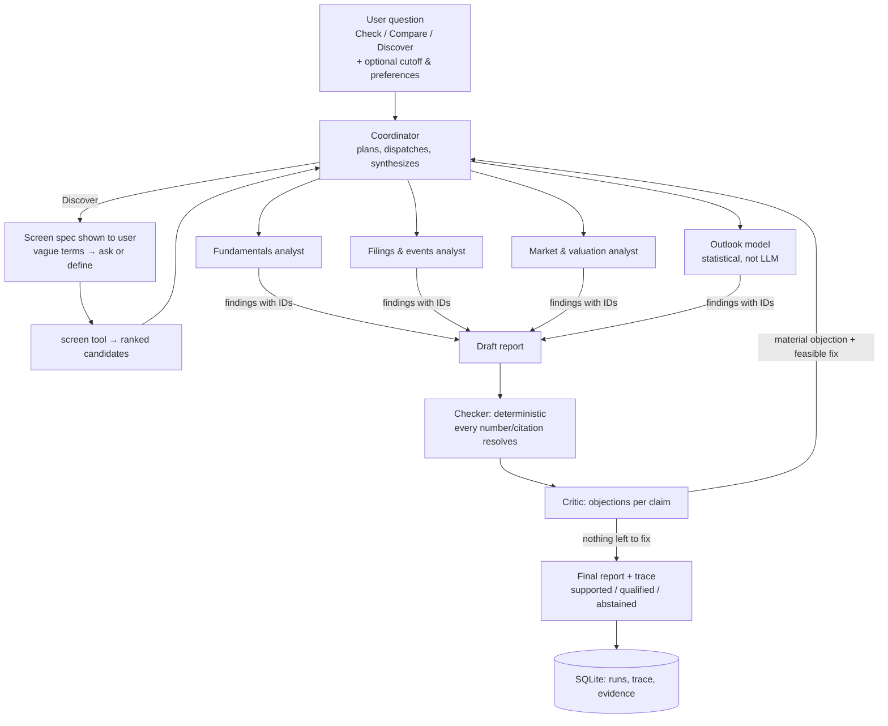
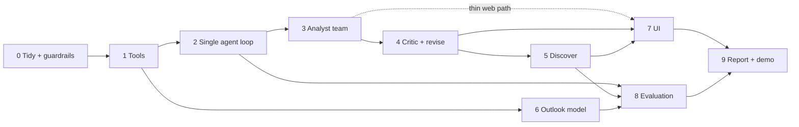

# Project Guide

**The one page to read.** It covers what we're building, where we are and what to do next. Details (rules, finance cautions, evaluation protocol, forecast spec, every external link) live in [docs/REFERENCE.md](docs/REFERENCE.md). Everything older is history.

Revised 2 November 2026 after reviewing the code, the course guideline and every old doc.

---

## TL;DR

- **Product:** an AI **equity research team** for US stocks. You can **Check** a stock ("is this a good business, what are the risks, what's the outlook?") or **Discover** stocks that match what you want, with every number traced to a source.
- **Agentic core:** a coordinator plans the work and sends it to specialist analysts (fundamentals, filings & events, market & valuation). They use real tools. A critic challenges the draft and the team fixes what it can. A separate statistical model gives the outlook.
- **Where we are:** the data plumbing, storage and UI work, the Phase 1 tools (`tools/`, 8 tools), the Phase 2 single agent (`agents/`, CLI only, condition B), the Phase 3 analyst team (CLI `--condition C`), the Phase 4 critic with its revision loop (CLI `--condition D`) and Phase 5 Discover over a declared universe (CLI `--universe`) are built. **The UI hookup isn't.** The web app still runs the old fixed pipeline plus two LLM calls that only add comments (baseline A).
- **Approach:** don't rewrite. Build `tools/` and `agents/` **next to** the existing code. The old pipeline becomes evaluation baseline **A**. Remove old scaffolding only where it blocks the new work.
- **AI is always on.** It was "optional" only because it wasn't built. A no-LLM mode remains only as baseline A and as a fallback when no API key is set.
- **Outlook (forecast) is parked.** It gets built after the core works; its spec is kept in REFERENCE §6, so nothing is lost.
- **Lesson from the Codex budget-cap mess:** no hidden token, cost or universe caps. Every limit lives in one config file, is generous by default, and finishes gracefully instead of failing (see §5).

---

## 1. What we're building

### Your original idea, checked against reality

> *"Check and forecast any stock or asset, or discover one or more stocks for users to trade or invest in the best way."*

Most of the idea holds up. Three parts need adjusting so the result is professionally defensible:

| Your idea | Keep / adjust | Why |
|---|---|---|
| **Check** any stock | ✅ Keep. "Any" means any US company that files with the SEC (about 6,000+), not 5 hard-coded tickers. | Fundamentals come from SEC filings. |
| Any **asset** (ETF, crypto, FX…) | ⚠️ Stocks get full analysis. ETFs could later get price-only analysis. Crypto and FX are out of scope. | They have no filings, so the fundamentals and risk-factor tools don't apply. They would need a different system. |
| **Forecast** | ⚠️ Keep as an **Outlook**: a statistical probability that the stock beats SPY over about a month, scored honestly. Not an LLM guess or a price target. **Parked until the core works.** | Short-horizon returns are close to a coin flip. An LLM can't be backtested fairly because it already "knows" the future of historical dates. A calibrated probability that we evaluate is defensible; "the stock will go up" isn't. |
| **Discover** stocks | ✅ Keep. Plain-English criteria → visible screen → research the top candidates → shortlist with reasons. | This is the strongest agentic demo: planning, tools, replacing candidates that fail. |
| Help users **trade/invest the best way** | ⚠️ Reframe as **decision support**. The user states preferences (horizon, risk appetite, style); the system gives a shortlist, a thesis, risks and what would change the view. No personal buy/sell advice. | "Best" can't be proven or evaluated in a course, and personalised investment advice is regulated. Decision support is honest, evaluable and still useful. |

**Something the original plan missed:** valuation and risk. A stock can be an excellent business and still a bad investment at its price. The original plan only used prices for the forecast. We add a **market & valuation analyst**: P/E, P/S, FCF yield, volatility, drawdown, beta vs SPY.

### What a user can do

| Mode | Example |
|---|---|
| Check | "Is NVIDIA's profitability sustainable? What are the main risks? What's the outlook?" |
| Compare | "Compare Apple and Microsoft: growth, margins, valuation." |
| Discover | "Find large US tech companies with operating margin above 25%, growing revenue and a reasonable valuation. Explain the top 3." |
| Honest failure | "What was this company's margin?" with a cutoff before the filing. The answer is "not available as of that date", not a guess. |

### How it meets the course rubric

| Course asks for | We provide |
|---|---|
| Planning / decomposition | The coordinator writes a plan and dispatches analysts. Discover mode interprets the criteria into a visible screen spec. |
| Tool use & selection | Analysts choose among SEC, price, calculation, filing-text and screening tools. |
| Multi-step execution | An agent loop per analyst plus coordinator orchestration. |
| Verification & self-correction | A deterministic citation and number checker, a critic, and a revision loop with defended / corrected / withdrawn / unresolved outcomes. |
| Multi-agent (optional) | The analyst team. We also test whether it beats a single agent. |
| Memory / state | Run trace and evidence stored in SQLite; reopenable history. |
| External data | SEC EDGAR APIs and a price data source. |
| Evaluation | Four conditions (A–D) on frozen cases, reporting accuracy, support, critic benefit and harm, cost and latency. |

---

## 2. How it works (target architecture)



**Tools** (each one plain Python; the LLM only picks one and fills in its arguments):

| Tool | Data | Status |
|---|---|---|
| `find_company` | SEC `company_tickers.json` + SIC sector | new |
| `get_financials` | SEC companyfacts: revenue, operating income, net income, cash flow, capex, shares, multiple years | extend `research.py` |
| `calculate` | margins, growth, FCF, valuation and risk ratios (pure functions) | extend `financials.py` |
| `read_filing_section` | 10-K Item 1A (risks), Item 7 (MD&A), split along section boundaries | new: `filings.py` fetches, edgartools parses |
| `list_filings` | recent 8-K events from SEC submissions | new |
| `get_prices` | daily raw + adjusted prices (Tiingo, yfinance backup; swappable, source always labelled) | new |
| `screen` | pass / fail / unknown over a universe, ranked by a stated rule | fix `screening.py` |
| `verify_against_filing` | cross-check a number against the 10-K's tagged financial data | **reuse the existing XBRL code as a critic tool** |
| `get_outlook` | statistical probability from the outlook model | later phase |

Role contracts, objection outcomes, discover rules and security rules: [REFERENCE §2–4, §8](docs/REFERENCE.md).

---

## 3. Original plan vs what was built vs what we'll do

The last column says whether the earlier choice was good practice. Where it wasn't, the proposal fixes it.

| Aspect | Original plan (18 Oct) | Built so far | Proposed now | Why the change |
|---|---|---|---|---|
| User input | Research + Discovery forms | Form, 5 hard-coded tickers | One plain-English question box, any SEC-filing US stock | Forms aren't agentic; a fixed universe isn't a product |
| AI | Central | **Optional, off by default** | **Always on**. A no-LLM mode exists only as baseline A and as a fallback banner when no key is set. | It was only optional because it wasn't built yet |
| Analyst roles | Coordinator, filings, event, quant, critic | Names on log lines only | Coordinator, fundamentals, filings & events, market & valuation, critic | Same idea; quant split into numbers vs market |
| LLM tool use | Typed tools picked by the model | None | Core of the work | Course requirement |
| Review | Critic, ≤2 rounds, 4 outcomes | Critic records objections only; fake "check" | Real revision loop, 4 outcomes, stop when nothing is fixable | A fixed round count is arbitrary |
| Report content | Facts, interpretations, risks | Metrics + LLM comments without numbers | Facts, analysis with cited numbers (placeholders), **bull case vs bear case**, risks, what would change the view | Standard equity-research format (also used by TradingAgents) |
| LLM and numbers | Numbers must come from tools | LLM forbidden to write any digit | LLM writes `{calc:ID}` placeholders that the host fills in | The no-digit rule caused failures and unreadable text |
| Events | 8-K event specialist | None | `list_filings` in the filings & events analyst; news later | |
| Valuation & risk | Not covered | None | **Added** | A good business can be a bad investment at its price |
| Discover ranking | By forecast probability `p0` | Alphabetical | By the user's stated criteria. The outlook is shown, never used to rank. | `p0` is close to a coin flip; ranking on it is noise. Alphabetical is a bug. |
| Forecast | Required for completion | Stub that says "unavailable" | **Parked** Outlook component; spec kept in REFERENCE §6 | Optional add-on; don't block the core on it |
| Run modes | Fresh / frozen / replay | Shown to the user as choices | **Internal**: evidence cache (for evaluation) + "open saved run". The user just asks. | Implementation detail leaked into the UI |
| Cutoff date | Required | Required; defaults to yesterday | Defaults to **now**; a historical cutoff is an advanced option | Most users want today's view |
| LLM API | Responses API mandated | Responses API | Chat Completions + tools (works with OpenRouter, DeepSeek, Azure/HKU) | Portability. Responses is fine if staying on OpenAI. |
| Limits | 12 LLM / 20 tool calls | Caps added, broke calls, removed | One config file, generous, graceful (§5) | Unmeasured caps break things |
| Run control | No cancel | One run at a time, no cancel | Cancel button; eval runs in parallel outside the API | Agent runs take minutes |
| Precision & IDs | Decimal, hashed IDs, immutable tables | All built | Keep where it already exists; don't add more | Not harmful, just heavy |
| Evaluation | A–D, 80 cases, double-labelled | None | A–D, about 40 cases (dev + held-out), a sample double-checked | 80 is unrealistic for the team |
| Process | — | C0–C10 lanes, R0–R10 resource packs, handoff ledgers | Phases + 5 roles + AGENTS.md + CI | Process overhead buried the goal |
| Stack | React + FastAPI + SQLite | Built | Keep | Good choice |

Nothing important from the original is dropped (everything is in [REFERENCE](docs/REFERENCE.md), including all resources). Valuation and the bull/bear framing are the additions.

---

## 4. Where we are: is it correct?

**Works and is reusable:** SEC companyfacts fetch with cutoff filtering (the fact selection logic is sound: it uses real period dates, not the misleading `fy` field), the 10-K download, the margin calculation, pass/fail/unknown screening, the SQLite store, History, the evidence viewer and the FastAPI + React shell. Token and cost tracking will be useful for the evaluation.

**Wrong or misleading today:**

| Problem | Where | Fix |
|---|---|---|
| The "tool check" after the critic recomputes the same number from the same inputs, so it can never disagree | [application.py:355](src/research_assistant/application.py:355) | Replaced by the revision loop + `verify_against_filing` |
| The MSFT "3% → 15% correction" in the UI is hard-coded fake data | [fixtures.py:26](src/research_assistant/fixtures.py:26) | Remove it once a real correction case exists |
| The interpretation prompt is just the words "Filings interpretation" | [prompts/interpretation.txt](src/research_assistant/prompts/interpretation.txt) | New role prompts |
| Any digit rejects the whole LLM answer (a big part of the ~40% live failures) | [application.py:339](src/research_assistant/application.py:339) | Numbers become `{calc:ID}` placeholders; the checker flags strays instead of rejecting everything |
| Screen picks winners **alphabetically** | [screening.py:18](src/research_assistant/screening.py:18) | Rank by the stated rule |
| "Qualified" badge shown but never computed | [contracts.py:201](src/research_assistant/contracts.py:201) | Compute support status |
| Only valuation-free quality metrics | — | Market & valuation analyst |

**Defaults and choices that made no sense** (like the "optional AI" one):

| Choice today | Why it's odd | Fix |
|---|---|---|
| AI analysis optional, unchecked by default | The AI *is* the product | Always on; no-LLM mode only as baseline/fallback |
| App opens on **replay of a synthetic example** | First impression is fake data | Opens on an empty question box + recent real runs |
| User must choose fresh / frozen / replay | Internal concept | "Ask" or "open saved"; cache handled internally |
| Model "connection test" asks for consent to send evidence and incur charges | Ceremony around a ~$0.002 call | A simple "Test connection" in settings |
| Forecast card always says "Unavailable" | Shows a non-feature | Hide until the Outlook exists |
| Model failure is treated as fine because "financials are preserved" | In an agent, the LLM is the driver | Retry, then mark the run partial/failed clearly |
| Interpretations must be "qualitative only" | Analysis without numbers is useless | Numbers via placeholders |
| Cutoff required, defaults to yesterday | Odd for a "what's the situation now" question | Default to now |
| Separate Research and Discovery forms | Users don't think in modes | One box; the coordinator decides |

**Finance scope limits to state openly:** banks and insurers (no operating income line), foreign filers (IFRS), restated values (today's SEC data, not the original vintage) and survivorship (today's ticker list). See [REFERENCE §5](docs/REFERENCE.md#5-finance-and-data-cautions).

---

## 5. Caps and hidden assumptions (the Codex budget-cap lesson)

What went wrong before: a 2,000-output-token cap cut off reasoning-model answers, so calls "failed". The cap was never measured and nobody chose it on purpose.

### Rules from now on
1. **No output-token caps, and no token or cost quotas by default.** Record usage, and let the provider's own limits apply. A cost budget is opt-in only.
2. **Loop guards are not quality caps.** Agents need a max-step guard against infinite loops. Make it generous (about 30–40 steps). When it's reached, **write the best partial report and mark it "stopped at limit"**. Never error out.
3. **Every tunable lives in one file** (`config.py`) with a comment saying why. No magic numbers in the code.
4. **Retry transient errors** (429/5xx) with the SDK's retry logic. Don't fail on the first network blip. Agents retry more patiently (`AGENT_MODEL_RETRIES`) and let OpenRouter fall back to another host of the same model, recording the serving host per call; baseline A keeps the SDK default and one host.
5. **Never hard-code the universe**, the sector list or result counts.
6. **Flag, don't reject.** A small problem in an LLM answer becomes a flagged item, not a thrown-away answer.
7. **Never silently truncate** input or output. If something is too big, say so.
8. **Missing configuration degrades; it never crashes.** A data provider without its key is skipped and shown as "not configured" on the status page. A fallback to another provider is always labelled ([REFERENCE: data providers](docs/REFERENCE.md#data-providers-by-kind-options-and-order)).

### Current code: what limits things, and how hard is it to fix?

| Hard-coded limit / assumption | Where | Effect | Fix effort |
|---|---|---|---|
| 5 tickers (`UNIVERSE`, `Ticker` Literal) | [contracts.py:8-15](src/research_assistant/contracts.py:8), used in ~8 files | No other stock possible | Medium. The new tools use `find_company`; the old pipeline can keep its 5. |
| Store re-validates every fact against `UNIVERSE[ticker]` | [store.py:122-165](src/research_assistant/store.py:122) | **Breaks any new ticker** | Done (Phase 0) |
| Sector Literal (4 values) hard-coded per ticker | [contracts.py:38](src/research_assistant/contracts.py:38) | Wrong for most companies | Easy: SIC code from SEC |
| Screen: margin only, 1–5 results | [contracts.py:39-40](src/research_assistant/contracts.py:39) | Can't express real criteria | Easy (new `screen` tool) |
| `max_retries=0` on the LLM client | [model_access.py:42](src/research_assistant/model_access.py:42) | One network blip = failed call | Done (Phase 0): SDK default retries |
| No-digit rejection | [application.py:339](src/research_assistant/application.py:339) | Throws away whole answers | Easy |
| Exactly one interpretation + one critic call | [application.py:284](src/research_assistant/application.py:284) | No loop | This *is* the agent work |
| One worker, one active run at a time | [application.py:128](src/research_assistant/application.py:128), store index | Evaluation can't run cases in parallel through the API | Easy: the eval runner calls agents directly |
| Annual 10-K, USD, `us-gaap`, `OperatingIncomeLoss` only | [research.py:53](src/research_assistant/research.py:53) | Banks and foreign filers come back "unknown" | Keep, but report "unsupported" clearly |
| Responses API + strict per-request schema | [application.py:303](src/research_assistant/application.py:303) | Many providers don't support it | Agents use Chat Completions + tools |
| 25 MB SEC response cap | [filings.py:13](src/research_assistant/filings.py:13) | Probably fine | Move to config |

### Limits in our own plans, made explicit

| Limit | Default | Why it exists | On reaching it |
|---|---|---|---|
| Agent steps per analyst | ~30 | Infinite-loop guard | Finalize partial, mark it |
| Critic rounds | stop when no material objection has a feasible fix (guard: 3) | More rounds can hurt quality | Remaining objections → unresolved |
| Discover candidates researched | top-k (`DISCOVER_DEFAULT_TOP_K` = 3 when the question doesn't say) + `DISCOVER_MAX_REPLACEMENTS` (3, `--replacements`) research runs; rejections by the 10-K check don't count | Time and cost | Return fewer, with the reason |
| Filing chunks | split on section/table boundaries, not a fixed character count | Retrieval granularity | Agent can request more chunks |

---

## 6. Old scaffolding: does it get in the way?

| Scaffolding | Gets in the way? | Decision |
|---|---|---|
| Fact provenance re-check against the fixed universe | **Yes**: breaks new tickers | Removed in Phase 0 (the check against the source filing stays) |
| XBRL 10-K re-parse on every fetch (3 extra downloads; fails if basis/scope text is missing) | **Yes**: slow, and makes many companies "unavailable" | Make it optional: becomes the `verify_against_filing` tool |
| Strict contracts (`extra="forbid"`, Literals) + legacy migration | Somewhat: every new field touches 3+ files | New agent code uses its own simple models; leave the old ones alone |
| Idempotency keys, single worker, process lock | Slightly: only the API path | Keep for the UI; eval bypasses it |
| Fresh / frozen / replay | No, it's useful | Keep; simplify into an evidence cache + replay |
| Connections page | No | Hide later |
| Token, cost and status telemetry | No, it's useful | Keep (needed for cost/latency metrics) |
| CSRF / host middleware | No | Leave |

**Approach: build beside it, don't rewrite.** The new `tools/` and `agents/` packages call into existing code where it helps. The old pipeline stays as baseline A. Delete old pieces only when they block something.

---

## 7. Advanced techniques: needed or not?

Rule: add a technique when a **measured** problem calls for it, not because it's popular.

| Technique | Needed? | Decision and trigger |
|---|---|---|
| **RAG over filings** | Yes, a simple version | Split 10-Ks by section (Item 1A, 7, …). If a section fits the model's context, **just give it the whole section**. Otherwise use keyword search (SQLite FTS5 / BM25) within that company's filings. Phase 1. |
| **Vector DB / embeddings** | Not now | Add only if the evaluation shows keyword retrieval missing relevant passages, or for cross-company semantic questions ("who mentions Taiwan supply risk?"). Then use `sqlite-vec` or plain numpy, not a separate DB server. |
| Hybrid search + reranker | Not now | Only after embeddings, if precision is a measured problem |
| GraphRAG / knowledge graph | No | Our data is already structured (XBRL) |
| Function calling + structured outputs | **Yes** | Core (Phase 2) |
| Plan-and-execute (coordinator) + ReAct loop (analysts) | **Yes** | Core (Phases 2–3) |
| Reflection / critic | **Yes** | Phase 4 |
| Human-in-the-loop clarification | **Yes** | Discover asks about vague terms (Phase 5) |
| Agent framework (LangGraph, CrewAI, AutoGen, OpenAI Agents SDK) | Not now | A plain loop is ~150 lines and easy to explain. Reconsider if pause/resume or complex branching becomes painful; then pydantic-ai is the first to try (it has an OpenRouter provider). |
| Parallel analysts (asyncio) | Later | When latency annoys; easy once tools are pure functions |
| Streaming trace to the UI (SSE) | Later | Polling first |
| Memory across runs ("what changed since last check", watchlist) | Later | Nice extension; reuse saved runs |
| Model routing (cheap model for analysts, stronger for coordinator/critic) | Later | Worth an evaluation row if cost matters |
| Prompt caching | **Already on** | The model's hosts cache automatically; measured in Phase 8 |
| Expose tools as an **MCP server** | Optional | Cheap once `tools/registry.py` exists; lets Claude/other clients use our tools. Good demo bonus. |
| LLM-as-judge | Evaluation triage only | Never the sole ground truth |
| Tracing platforms (Langfuse, LangSmith) | No | Our SQLite trace is enough |
| Fine-tuning, RL, factor mining, trading execution | No | Out of scope |

---

## 8. Codebase structure for a team

Teammates (and their AI coding tools) won't always read docs, so **the structure itself has to guide them**.

### Target layout (grow into it; no big-bang move)

```text
src/research_assistant/
  config.py        # ALL tunables + model names, with comments
  data/            # external data only: providers.py (registry + status), sec.py, prices_<vendor>.py, cache.py
  finance/         # pure calculations (no I/O): margins, growth, valuation, risk
  tools/           # one file per tool + registry.py (name, schema, function)
  agents/          # loop.py (generic tool loop), roles.py, runner.py (one run, B and C), team.py (coordinator + analysts), critic.py
    prompts/       # one .md per role
  outlook/         # statistical model: train offline, predict as a tool
  pipeline.py      # today's deterministic flow = baseline A
  store.py         # SQLite runs, trace, evidence
  api/             # FastAPI routes only
eval/
  cases/           # one YAML per case (question, cutoff, gold answers)
  run_eval.py      # runs conditions A–D
  score.py
frontend/src/
  pages/  components/  api.ts   # split the 47 KB App.tsx
tests/             # mirrors src/; network always mocked
```

**Dependency direction:** `finance` ← `data` ← `tools` ← `agents` ← `api`. `finance` never does I/O, tools never call an LLM, and agents never call HTTP directly. This one rule keeps the modules swappable.

### Recipes (make the right thing the easy thing)
- **Add a tool:** create `tools/<name>.py` with a typed input model and a function, register it in `tools/registry.py`, and add one test with a fixture. Agents pick it up automatically.
- **Add an analyst:** add `agents/prompts/<role>.md` plus one entry in `roles.py` listing its tools. No new loop code.
- **Add an eval case:** add a YAML file in `eval/cases/`.
- **Add a data provider:** write `data/<kind>_<vendor>.py` with `fetch()` and `check()`, register it in `data/providers.py` with its tier and required env variables, and add those variables to `.env.example`. It appears on the status page automatically and is skipped until it's configured.

### Guardrails that work without anyone reading docs
- **`AGENTS.md`** (read automatically by Codex and most other coding agents) **+ `CLAUDE.md`** (one line, `@AGENTS.md`, so Claude Code imports the same file) holding about 10 rules: layout, dependency direction, the "no hidden caps" rules, check the adopt-or-build table before adding a dependency, pin versions, tests required, mock the network, keep files small, update `PROJECT_GUIDE.md` checkboxes and don't create new docs.
- **CI on every push/PR** (GitHub Actions): `pytest`, `ruff` lint/format and `tsc`. Red CI means no merge.
- **Pre-commit hook** running ruff, so formatting arguments never happen.
- **PR template** with a 4-item checklist: tests added, config not bypassed, no new docs, guide checkbox updated.
- **One personal branch per person (no new branch per phase or task), one commit per subtask**, then a PR to `main` that the repo owner reviews, and protect `main`.

"Scaling" here means more tickers and parallel evaluation runs: cache SEC and price responses, respect SEC's 10 req/s, run tool calls concurrently. It does **not** mean microservices, queues or vector DBs.

### Switching between AI coding tools (Claude Code, Codex, …)
Switch whenever a quota runs out. Nothing in the project is tied to one tool. What makes switching safe is that **the repo holds the context, not the chat**:
1. **One rules file.** `AGENTS.md` has the rules, and `CLAUDE.md` only imports it. Never keep two copies.
2. **Decisions go into this guide or REFERENCE before you switch.** Chat history and each tool's private memory don't carry over.
3. **Switch at a clean point.** Commit the current subtask (a WIP commit is fine) and tick its checkbox. Avoid switching in the middle of a design discussion.
4. **Give the new tool one checkbox, not "continue the project".** For example: *"Read AGENTS.md and PROJECT_GUIDE.md. Do the Phase 1 task `get_prices` as described in docs/REFERENCE.md §10. Done when its fixture test passes. Don't create new docs."*
5. **One tool per branch at a time.** Two agents in the same working tree overwrite each other; use separate branches or git worktrees.
6. **Review when you switch back.** Have the next tool, or a teammate, review the previous tool's commits before merging, with CI green. Unreviewed AI output is how the doc sprawl and the hidden token cap happened.

---

## 9. Plan



### Phase 0: Tidy + guardrails
- [x] Commit the current tree as a checkpoint ("chore: checkpoint before agent work").
- [x] Add `AGENTS.md` + `CLAUDE.md`, CI (pytest, ruff, tsc) and a PR template.
- [x] Move old planning docs (STATUS, design, workstreams, sources, c1-handoff, integration, tasks/) into `docs/archive/`. Cut the README down to "what + how to run + link here".
- [x] Add `.archify/`, `graphify-out/` and `verification/packets/` to `.gitignore` (keep them locally). Tests that read the packet skip when it's missing, so CI skips them.
- [x] Quick fixes: `max_retries` default, remove the store's UNIVERSE re-check.
- [ ] Optional, any time: run `ruff format` once over the old code in its own commit, then enforce it in CI and a pre-commit hook. Until then CI runs only bug-catching lint rules.
- [ ] Protect `main` on GitHub (Settings → Branches): require a PR and green CI.

### Phase 1: Tools
**Adopt before you build.** Before writing a tool or adding a dependency, check the [adopt-or-build table](docs/REFERENCE.md#adopt-or-build-tool-by-tool-survey-of-2-nov-2026). Most tools are ours, built over SEC JSON. The exceptions:
- **Filing sections:** parsed with edgartools, pinned, over bytes we fetch ourselves.
- **Valuation formulas:** copied from FinanceToolkit.
- **Prices:** yfinance works with no key; Tiingo goes first when its key is set.

Licences don't matter here (it's an academic project): calling a library and copying its logic are both fine, whichever is easier. If you find a better library, add a row to that table, not a new doc.
- [x] `config.py`, `data/sec.py`: one SEC client with a disk cache (archived filings kept forever, JSON APIs refreshed after a day) and one 10 requests/second limiter shared by the whole process.
- [x] `find_company`, `get_financials` (multi-year, more concepts), `calculate`.
- [x] `data/providers.py`: one registry of providers per data kind, with tier, required env variables and `check()`. Add `GET /api/status`, and list every variable in `.env.example` with its tier.
- [x] Gate for edgartools: section extraction matches a hand-checked sample of ~10 filings (including a bank and a 20-F) before `read_filing_section` relies on it.
- [x] `read_filing_section`, `list_filings`, `get_prices`, `screen` (ranked), `verify_against_filing`.
- [x] Each tool returns `{status, data, ids, source, warnings}` and has a fixture test.
- [x] Commit small, trimmed SEC fixtures so CI covers filing parsing: `tests/fixtures/` (rebuilt by `build_sec_fixtures.py`); the old packet tests now run in CI on a 64 KB trimmed copy.
- [ ] Later, only once an eval case needs it: a period choice (annual, quarterly, TTM) for `get_financials`, following REFERENCE §5. It returns 10-K annual values only, so team runs can't cite NVIDIA's fiscal-2027 10-Q quarters; on 3 Nov 2026 none of the 14 dev cases in `eval/cases/` asked for an interim, quarterly or TTM figure (all gold is annual, from a 10-K or 20-F).
- **Done when:** every tool gives correct, cited output for 10+ companies, including a bank and a foreign filer (which must come back "unsupported", not crash).
  - Checked live on 3 Nov 2026 for 13 companies (AAPL, MSFT, NVDA, AMZN, GOOGL, KO, JNJ, WMT, XOM, JPM, C, TSM, BABA): every revenue figure `verify_against_filing` checked matched the original filing; bank operating income and TSM (IFRS) come back unsupported. Known cases: XOM's ticker now points to a new holding company with no 10-K yet (history is under predecessor CIK 34088, and `find_company` says so); BABA's USD figures are convenience translations of CNY and are flagged; one-year betas from Yahoo look low (KO −0.28, XOM −0.72; the maths matches numpy), so cross-check them with Tiingo before the evaluation.

### Phase 2: Single agent loop
- [x] `agents/loop.py`: plan → Chat Completions tool-calling loop → structured draft with `{fact:ID}`/`{calc:ID}` placeholders → deterministic checker. Trace saved.
  - The trace is one append-only JSONL file per run in `data/traces/` (every model call, tool call, result and token count). It moves into SQLite when the UI needs it (Phase 7).
  - Condition B includes REFERENCE §7's one self-review pass: when the checker flags the draft, the flags go back to the model once (`AGENT_SELF_REVIEW_PASSES`); leftover flags stay visible in the report. The report already uses the Phase 3 shape (summary, key numbers, bull vs bear, risks, what would change the view, limitations) so A–D compare like for like.
- [x] CLI: `python -m research_assistant.cli "question"`.
- **Done when:** the Check and Compare examples give sensible, fully cited reports. This set-up is evaluation condition **B**.
  - Checked live on 3 Nov 2026 with `deepseek/deepseek-v4.1-flash` on OpenRouter: Check (NVIDIA) and Compare (Apple vs Microsoft) both finished with every section cited and no checker flags left after the self-review pass (first drafts: 3 and 22 flags, mostly figures copied from filing text). About 3 minutes, 12–13 model calls, 60–75 tool calls, 0.6–0.75 M tokens and $0.03–0.08 per run (prompt tokens dominate: each step resends the whole context, so prompt caching is the first cost lever). Reports cite fact, calc, filing-text and verify_against_filing records, attribute management claims, flag misaligned fiscal years and say no outlook model exists. Fixed during the check: upstream 429s (agents now retry 6 times and let OpenRouter use another host of the same model), a NaN Yahoo close that crashed market_cap, tool exceptions that ended a run, and checker false positives (citations written as `calc:ID`, names such as H20 or SIC 3674).

### Phase 3: Analyst team
- [x] Coordinator + the 3 analyst roles as configs of the same loop. The coordinator merges findings into a report: summary, key numbers, **bull case vs bear case**, risks, and what would change the view.
  - `agents/roles.py` lists each role's tools (decisions in REFERENCE §2), `runner.py` is the one run B and C share (plan → lead's loop → checker → self-review → report), and `team.py` makes each analyst an `ask_<role>` tool in the coordinator's loop. An analyst keeps its conversation for follow-ups and hands in findings that are checked, get claim IDs and can be cited by claim ID. Every trace event names the role that wrote it, `run_end.by_agent` has calls, tokens and cost per role, and the report lists who was asked what. CLI: `--condition C`.
- [x] Each role can run only its own tools. The loop answers any other tool call with an "invalid" result instead of running it (before, it only hid the other tools' schemas).
- [x] Claims get stable IDs and versions (REFERENCE §3), so Phase 4 can show exactly which claim the critic changed.
  - `agents/claims.py`: a claim's ID comes from its first wording (`claim-…`) and is kept when the model repeats it in the claim's `id`; the version goes up only when the text, resolved citations, kind or materiality change. Each `check` event lists new, revised, unchanged and dropped claims, and `run_end` keeps every version.
- [x] Frozen evidence: the trace keeps every tool result in full, including the daily prices behind a calculation, so a saved run can be reopened and its numbers rechecked offline. Files are enough; SQLite waits for Phase 7.
  - Each `tool_call` event carries the records that call added, in full and once per run; `run_end` keeps the final draft. `agents/evidence.py` (CLI `--recheck TRACE`) recomputes every calculation from its frozen inputs and refills the report's placeholders, with no network or model, and lists any mismatch. Traces saved before this change hold no records and say so.
  - A price series' ID covers its rows (decided 3 Nov 2026, after the Phase 4 check). When an analyst fetched a series again, Yahoo's adjusted closes came back with float noise under the same ID, and the recheck then used the later rows for a beta made from the first ones. Now each version gets its own ID, so both stay frozen. Older traces can still hold two versions under one ID, so `--recheck` tries every frozen version of a calculation's inputs: `20261103-092422-ca0f2d` and `-093422-454c86` now match. `-093422-de8bbe` still flags one beta, correctly: it reviewed `ca0f2d` and copied only the later rows, so the rows that beta came from are not in that trace.
- **Done when:** the same questions work, and the trace shows which analyst did what (condition **C**).
  - Checked live on 3 Nov 2026 with `deepseek/deepseek-v4.1-flash` on OpenRouter. Check (NVIDIA) and Compare (Apple vs Microsoft) both finished with every section cited and no checker flags left after the self-review pass (first drafts: 4 and 8 flags). The coordinator asked all three analysts in one step; the Check run took 32 model calls, 2.2 M tokens, $0.08 and 14 minutes, the Compare run 23 calls, 0.7 M tokens, $0.09 and 3 minutes. `--recheck` matched every calculation (84 and 56) and every report statement offline. Fixed during the check: the coordinator left `citations` out of its interpretations, so two earlier Check runs ended with 26 and 21 uncited statements, and its self-review resubmitted them unchanged. Now the claim schema lists `citations` as required (this also changes B's `submit_report` schema; a missing list is still flagged, not rejected), findings can be cited by claim ID, and the self-review names a reused claim's earlier citations. Copied claim IDs with a stray character are read as the claim they extend. Cost varies a lot: the two earlier Check runs took 74 and 38 model calls ($0.27 and $0.16), mostly the filings analyst resending whole filing sections each step. Across the four runs C used 0.7–6.4 M tokens and $0.08–0.27, against B's 0.6–0.75 M and $0.03–0.08 (Phase 2), so prompt caching is still the first lever.

### Phase 4: Critic + revision
- [x] Critic objections (issue types in REFERENCE §3) → coordinator → analyst follow-up → defended / corrected / withdrawn / unresolved. Claim versions kept.
  - `agents/critic.py` is condition D (CLI `--condition D`): C's run, then up to `AGENT_CRITIC_ROUNDS` (3) reviews by a critic role (`prompts/critic.md`, read-only tools plus `verify_against_filing`). Each objection names a claim ID and version, an issue type, the records that show it and a requested check. The coordinator routes it to the owning analyst through `ask_<role>` and hands in `submit_revision`: the whole report plus one outcome per objection. The claim ledger settles each outcome (REFERENCE §3), the trace has `critic_start`, `objections`, `revision_start` and `outcomes` events, `run_end` keeps every objection and withdrawal, and the report gets a Review section. `--review TRACE [--inject wrong_period]` runs the same review on a saved draft (REFERENCE §7 isolated review test).
- [x] B's self-review pass checks the same issue types as the critic (wrong period, unsupported inference, missing risk…), not just checker flags, so B vs D is a fair comparison.
  - The pass now always runs once, also on a draft the checker passes, with the critic's issue list, claim view and evidence view (REFERENCE §7). It is shared by B, C and D, so every clean run costs one more lead call.
- **Done when:** an injected wrong-period or wrong-unit error is caught and corrected, and a clean case stays unchanged (condition **D**).
  - Checked live on 3 Nov 2026 with `deepseek/deepseek-v4.1-flash` on OpenRouter, using `--review` on saved Compare (Apple vs Microsoft) drafts. `--inject wrong_period` swapped the key number "Apple revenue, fiscal year ended 2025-09-27" for the fiscal 2023 fact ($383.3 billion instead of $416.2 billion). The checker passes that (0 flags); the critic raised it in round 1 as a material wrong period, and the revision cited the fiscal 2025 fact again (v2 injected → v3), in both runs. **Clean case:** a draft the critic had already passed, reviewed again, kept all 43 statements and every claim version; its 2 minor objections were shown, not routed (10 model calls, $0.11, 5 minutes). On the original Phase 3 draft the critic also found 2 real contradictions the checker can't see ("keeps expanding cash generation" while free cash flow fell; "the two reversed" though Apple out-returned Microsoft over both windows), the same 2 with or without the injection, and nothing on the untouched key number. A full `--condition D` run ("Apple's revenue and operating margin in its latest fiscal year, and the change") caught that the draft denied any material event while an 8-K filed 2026-04-20 announced a CEO transition, and a missing key-personnel risk, corrected by adding claims; one minor objection was left unresolved. Runs took 10–41 model calls, 1.1–4.7 M tokens, $0.11–0.39 and 5–27 minutes; the critic's brief (whole report plus evidence) dominates, so prompt caching is still the first lever. The critic varies between runs: one of two reviews of the passed draft also raised a stale-price objection (closes through 2026-10-30 when 2026-11-02 was available) and the other didn't. `--recheck` matched every calculation in the D run and the first injected review. In the other three review traces one beta differs in the 6th decimal: in two reviews the market analyst refetched a price series under the same record ID, Yahoo's adjusted closes came back with float noise, and the trace keeps only the latest rows (the third trace started from one of those). Fixed during the check: a missing-risk objection is corrected by an added claim, a report claim cited as evidence resolves, typed figures in objections are one note, and a review trace freezes the evidence it starts from.

### Phase 5: Discover
- [x] Question → visible screen spec (ask about vague terms) → `screen` → research top-k → replace failures → shortlist with counts.
  - CLI `--universe sp500_tech` (or a YAML file). A screener role writes the spec: screen filters, ranking, top-k, price checks (P/E, P/S, market cap…, which need prices, so they run per candidate) and each vague term with a definition and a question. An interactive terminal asks each question; `--define TERM=MEANING` answers up front; an unanswered term is shown as "assumed". The spec is printed before anything runs. Then the host walks `screen`'s ranking: a deterministic check on the latest 10-K and close (`agents/acceptance.py`, no model, every line cited), then a research run by `--condition` B, C or D with its own trace. A rejected or failed candidate is replaced by the next one. Details and the bundled universe in REFERENCE §4.
- **Done when:** the Discover example works on a declared universe of about 50–100 companies.
  - Checked live on 3 Nov 2026 with `deepseek/deepseek-v4.1-flash` on OpenRouter: the Discover example over `sp500_tech` (94 companies), each pick researched by condition B. Run `20261103-132222-311a68`: the screener listed four vague terms ("large", "reasonable valuation", "top", "tech companies"), each shown with its definition and labelled assumed (no terminal to ask). 30 of 94 passed the screen (operating margin above 25%, revenue growth above 0). The host checked 5 on their latest 10-K and close and rejected 2: NVIDIA (P/E 41.1x, above the 30x cap) and VeriSign (unknown: no `NetIncomeLoss` fact). It researched AppLovin, Fair Isaac and Microsoft; every section is cited, with no checker flags left (first drafts: 75, 29 and 16 flags, mostly the user's thresholds typed as figures). 37 model calls, 179 tool calls, 1.55 M prompt tokens of which 1.27 M (82%) cached, $0.17, 12 minutes. `--recheck` matched every calculation in all four traces.
  - The definitions vary between runs, which is why they are shown and labelled. Two earlier runs read "large" as a market cap of at least $50 billion (one also added P/S at most 10x) and returned AppLovin, Microsoft and Adobe after checking 10 ($0.15, 9 minutes).
  - Fixed during the check: a 200 reply whose body wasn't JSON crashed the whole process. It is now retried (`AGENT_BAD_REPLY_RETRIES`, 2), then fails like any other model error; a research run that still raises counts as a failed candidate and is replaced. Told only its screen rank (5), a research run wrote that Microsoft falls outside the top 3; the brief now says it is pick 3 and why the names above it are out. The screener no longer claims share classes can take two slots, and growth periods no longer read as two-year spans.
  - Known gaps, from all three runs (unknown never passes, so these companies are rejected): Meta has no share count in companyfacts (two share classes), VeriSign no `NetIncomeLoss` fact, and Broadcom no net income for its latest year. The host's price check for Microsoft and NVIDIA used a series cached earlier that day without the 2026-11-02 close, so it used 2026-10-30. Microsoft's research fetched a fresh series, so it shows P/E 28.2x where the check shows 29.0x. Fixed after the runs: a cached series whose last day has a blank close is now refetched after 30 minutes, not 24 hours (Yahoo still listed 2026-11-02 blank at 21:23 New York time).

### Phase 6: Outlook model (parked)
Don't design it in detail now. When someone has capacity after Phase 4, start from [REFERENCE §6](docs/REFERENCE.md#6-outlook-forecast-specification). A price-based statistical model can be tested on history with proper walk-forward splits. Anything that uses an LLM can't, because the model already knows what happened later; for that, only a prospective log (predictions saved now, scored later) is a clean test, so start it early.

### Phase 7: UI
- [ ] **Start right after Phase 3:** a thin web path. Question → agent run → cited report → saved → reopened from History, on the existing page. This is mostly backend work (API, storage, cancel), so give it one owner. The full layout and Discover screen come later.
- [ ] One question box (no mode, model or cutoff toggles up front; advanced options folded away) + preferences → live trace timeline + cancel button → report with clickable citations and statuses. Opens on an empty box plus recent runs, not a synthetic example. Reuse the evidence panel and History. Split `App.tsx`.
- [ ] **Setup & status page** (extends today's Connections page): one card per data kind, listing its providers with a status:
  - Ready (no key needed).
  - Configured.
  - Not configured, showing which `.env` variable to set.
  - Last check failed.

  Each card also shows which provider is active and has a Test button. Keys stay in `.env`, not typed into the browser. Drop the consent dialog around the model test.

### Phase 8: Evaluation (start writing cases during Phase 2)
- [x] Prompt caching measured before the A–D runs (§7's first cost lever). Trace totals now count `cached_tokens` per run and per role.
  - Nothing to switch on. Every OpenRouter host of `deepseek/deepseek-v4.1-flash` caches automatically ([docs](https://openrouter.ai/docs/features/prompt-caching)), reports `prompt_tokens_details.cached_tokens` and bills cache reads at 2–15% of its input price; `usage.cost` already includes the discount. Across the 13 traces of 3 Nov 2026, 74% of prompt tokens were cached.
  - Host fallback (`allow_fallbacks`) does break the cache: a call that moves to another host gets nothing cached. But sticky routing keeps a conversation on one host, so only 4 of 308 follow-up calls moved (about 0.8% of cost). Kept, because it outlasts upstream 429s. The other misses (at most about 7% of cost) happen inside a host, where no request option reaches. So no routing change, `session_id` or `order`.
  - Live check, 3 Nov 2026, NVIDIA Check question. **B:** 14 model calls, 0.76 M prompt tokens, 88% cached, $0.087 (about $0.28 without the cache), 33 min, of which 29 min were two slow `screen` calls (SEC downloads). **C:** 43 calls, 4.95 M prompt tokens, 43% cached, $0.68 (about $0.77 without), 49 min.
  - C's cost was mostly the filings analyst: on 7 calls its reasoning ran to 121k–131k tokens (6 hit the host's 131,072-token output limit; 4–8 min each), and each reasoning block was sent back with the next call, adding about 131k uncached prompt tokens per step. That was 78% of the run's cost. The same thing happened in two earlier D traces (market and critic roles). It is the next cost lever, not caching.
- [ ] About 40 cases (dev + held-out), gold labels from SEC data, a sample (at least 10) checked by a second person. Sources:
  - ~15 adapted from the FinanceBench open sample.
  - ~8–10 from the Vals Finance Agent public set.
  - ~5 fiscal-period traps in the style of FinRetrieval.
  - The rest hand-built (injection, bank, foreign filer, unknown ticker, restatement). See [REFERENCE §10](docs/REFERENCE.md#evaluation-datasets-and-papers).
- [ ] `eval/run_eval.py` runs A–D on frozen evidence and produces tables: accuracy, support, critic fixes vs damage, cost, latency, failures ([REFERENCE §7](docs/REFERENCE.md#7-evaluation-protocol)).

### Phase 9: Report + demo
- [ ] Report: problem → design → tools/agents → evaluation → failure cases → limitations and trade-offs.
- [ ] Demo: one Discover question live, one injected-error correction, one honest "not available"; cached runs as fallback.

**Out of scope** (list as future work): crypto/FX, news feeds beyond SEC 8-K (free options are listed in REFERENCE §10), trading or portfolio optimisation, factor mining, fine-tuning. Vector DB, MCP, memory and other add-ons follow the triggers in §7. Every resource from the earlier research is catalogued with a Now/Later/Ref verdict in [REFERENCE §10](docs/REFERENCE.md#10-resource-catalogue).

---

## 10. Team split (3–5 people)

| Role | Owns | Phases |
|---|---|---|
| Data & tools | `data/`, `finance/`, `tools/` | 1 |
| Agents | `agents/`, prompts, critic loop, discover | 2–5 |
| Outlook | `outlook/`, prospective log | 6 |
| UI | `frontend/` | 7 |
| Evaluation & report | `eval/`, gold cases, report, keeps this guide current | 0, 8, 9 |

With 3 people: merge Data + Outlook, merge UI + Evaluation/report, and keep Agents on its own.

---

## 11. Open decisions

| Decision | Recommendation |
|---|---|
| Price data source | Several providers (see [REFERENCE: data providers](docs/REFERENCE.md#data-providers-by-kind-options-and-order)). The zero-key default is **yfinance**. When `TIINGO_API_KEY` is set, **Tiingo** goes first, because it has raw (as-traded) prices plus split and dividend fields. Every result is labelled with its source. Get the free Tiingo key before the evaluation is frozen. |
| LLM | Keep OpenRouter with a cheap tool-calling model. Freeze the model ID before the evaluation. Check whether the HKU ITS quota supports function calling. |
| Framework | Plain Python loop. LangGraph only if the team already knows it. |
| Discover universe | Decided in Phase 5: a declared YAML list, stated as a survivorship-biased snapshot. Bundled: `sp500_tech` (today's S&P 500 Information Technology and Communication Services members); add others as files. |
| Outlook in the final demo? | Decide after Phase 4. If built, show it as a clearly labelled statistical card, never used for ranking. |

---

## 12. Docs map

| File | Purpose |
|---|---|
| `README.md` | What it is, how to run it |
| `PROJECT_GUIDE.md` | This file: vision, status, plan. **The only status doc.** |
| `docs/REFERENCE.md` | Rules, finance cautions, evaluation, forecast spec, resources, and the **adopt-or-build table** (check it before writing a tool or adding a dependency) |
| `AGENTS.md` / `CLAUDE.md` | Rules for humans and AI coding tools (Phase 0). `CLAUDE.md` only imports `AGENTS.md`. |
| `docs/archive/` | Old plans and records, kept for history; never the current instruction |
| `.archify/`, `graphify-out/` | Local visual aids, git-ignored; regenerate after the architecture changes |
