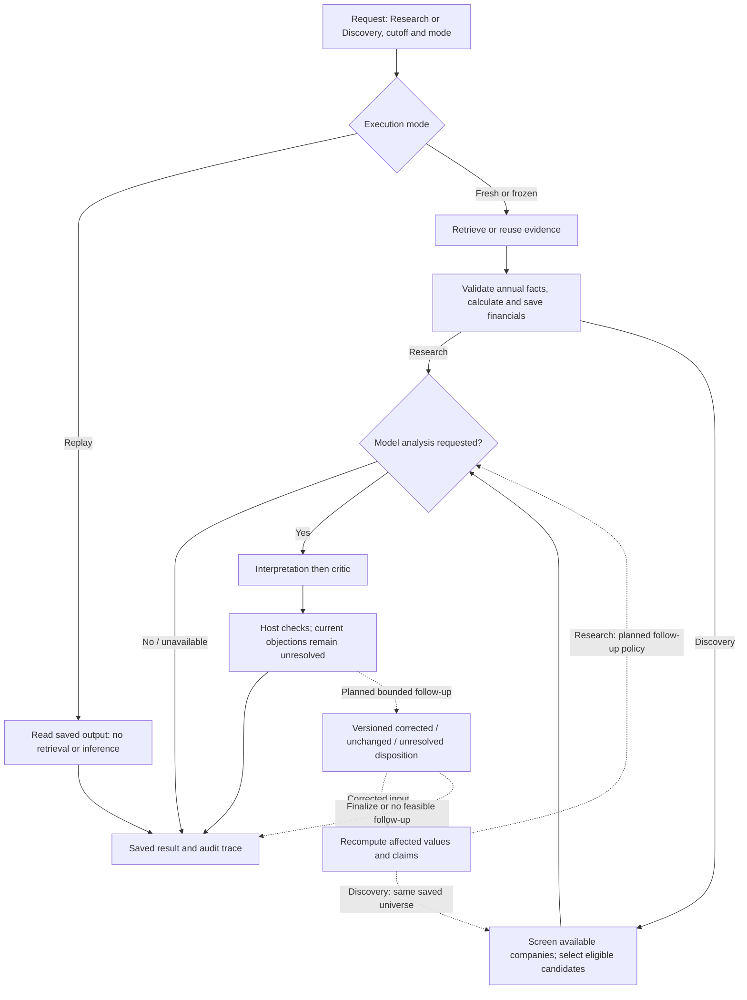

# Design and research protocol

[Start](../README.md) · [Current status](../STATUS.md) · [Sources](sources.md)

Keep one local application. Python owns evidence eligibility, calculations and execution control; model calls propose interpretations and checks. The research question is whether targeted review improves financial correctness without excessive cost or damage to correct claims. The application-level generation/run/spending quotas were removed on 1 November; provider limits and source protections remain.

## Research workflow at a glance

Open the [research workflow atlas](../.archify/index.html) to follow the complete current and intended execution, then drill into stages, mechanisms and engineering reference. Future steps share the graph with implemented steps and are explicitly marked. Forecast preparation/prediction and filing events are optional branches; evaluation consumes saved cases/results in a separate experiment workflow. Financial results are saved before model analysis, and available partial results survive a stopped run. A completed run does not establish research correctness.

### Alignment with the archived implementation plan

The [archived plan](archive/implementation_plan.md) preserves the original intent, not current implementation or an automatically accepted backlog. Code establishes actual execution; STATUS and Workstreams establish milestone state/scope; this document records stable behavior. In the table, **retained** describes intent, not proof that every proposed step exists.

| Archived behavior | Alignment | Current behavior / intended continuation |
|---|---|---|
| Shared Research/Discovery evidence, calculation and reporting path | Retained | Research loads one company; Discovery loads company financials, screens/selects, then reviews selected companies. |
| Coordinator chooses specialist tools and next actions | Implemented more narrowly | `Application` follows fixed host routing with bounded interpretation/critic calls. Five logical specialist roles and a general model-driven tool planner are not implemented or required by the core milestone. |
| Filings, facts and deterministic arithmetic | Retained | C1 implements the narrow annual USD packet/fact/margin path; independent packet review and C0 acceptance remain separate. |
| Up to two review rounds | Planned | Current code performs one finite interpretation/critic pass per reviewed company. Additional rounds and their stopping policy remain a design decision; the removed run quotas are not active gates. |
| Defended / corrected / withdrawn / unresolved objections | Superseded | The current core target uses corrected / unchanged / unresolved dispositions. Live runtime currently records unresolved only; the saved corrected example is synthetic. Do not introduce the archived four-way taxonomy implicitly. |
| Versioned correction, invalidation and candidate replacement | Planned | C4 must append resolutions, recompute affected dependencies and re-screen/replace within the saved universe and an agreed finite follow-up policy. None is established by current host recomputation text. |
| Forecast probability ranking | Optional/deferred | Current selection is alphabetical among eligible companies; browser sorting changes display only. Probability ranking requires an accepted forecast artifact and a separately agreed rule. |
| Statistical forecasts and event specialist in the initial complete design | Optional/deferred | C8/C9 are unselected extensions under current milestone order. Training/preparation is separate from request-time prediction; narrative review cannot alter immutable `p0`. |
| Cancellation and action-level retry/resumption | Decision needed | No cancellation or automatic checkpoint resumption exists. Uncertain submission recovery reuses a request/key; it is not action resumption or exactly-once remote billing. These are not new core requirements. |
| Research evaluation and independently checked cases | Retained | Protocol/case design, independent labels and held-out comparisons remain required evidence for research-quality claims; they are not a step in each user request. |
| Streamlit, proposed module filenames and historical four-week/team schedule | Superseded | React/FastAPI/SQLite and existing module ownership govern implementation. Archived filenames are responsibility sketches, not scaffolding instructions; the schedule is not a current commitment. |

### Original specialist roles and tools

The archived plan's five specialists are logical responsibilities. They are not five separate deployed services, and a function or action-log label does not establish an autonomous model agent. The atlas's **Specialists & tools** view explicitly maps each role to present code and future behavior.

| Original role | Present implementation | What remains proposed |
|---|---|---|
| Coordinator | `Application` validates requests and routes Research/Discovery through a fixed finite host workflow. | General model-selected next actions and full specialist delegation. |
| Filings specialist | Host SEC retrieval/annual selection plus one model interpretation of supplied evidence. | An agent that chooses filing-search tools and follow-up sources. |
| Quantitative specialist | Host-owned typed facts, `operating_margin`, immutable calculations and deterministic screening. | A separate tool-selecting Quant model role; forecasts remain unavailable. |
| Event specialist | No current event-specialist implementation. | Optional dated filing-event/risk extraction and its evidence path. |
| Critic | One structured model call with exact supplied claim/evidence references and allowlisted requested checks. | Version-targeted correction, resolution and automatic re-screening. Current objections remain unresolved. |

The named tools in the archive are proposed interfaces, not necessarily current function names. `get_fact` has a host-side counterpart in `Store.fact`; `calculate_metric` is currently the narrow `financials.operating_margin` formula; `screen_universe` corresponds only to `screen_companies` over the fixed supported universe. Issuer resolution is a static `UNIVERSE` mapping. General `list_eligible_filings`, `search_evidence`, `get_price_features` and `get_forecast` tool interfaces are not implemented. Annual eligibility/packet retrieval supplies only a narrower part of the filing-listing responsibility. Models currently receive evidence/metrics and cannot directly fetch URLs or execute arbitrary Python/SQL.

### Engineering reference

Frontend/backend ownership, storage and deployment explain how the workflow is implemented; they are secondary to the execution map above.

| Responsibility | Current owner | Why it stays here |
|---|---|---|
| Accessible screens, navigation and request recovery | [frontend/src](../frontend/src/) | Presentation never authorizes tools or computes authoritative financial values |
| HTTP validation and local access restrictions | [api.py](../src/research_assistant/api.py) | One boundary for all callers; serves the production UI too |
| Run lifecycle, shared research/discovery, model calls | [application.py](../src/research_assistant/application.py) | One worker serializes finite research/discovery workflows |
| Annual source selection and report assembly | [research.py](../src/research_assistant/research.py) | Select comparable annual inputs and assemble the saved report |
| Accession-specific source retrieval and byte locators | [filings.py](../src/research_assistant/filings.py) | Bound retrieval and preserve original filing identity and bytes |
| Typed fact normalization and versioned Decimal formulas | [financials.py](../src/research_assistant/financials.py) | Financial correctness belongs beside the inputs and formulas |
| Pass/fail/unknown screening | [screening.py](../src/research_assistant/screening.py) | Missing data cannot silently qualify a candidate |
| Transactions, idempotency and immutable source bytes | [store.py](../src/research_assistant/store.py) | Saved runs remain recoverable and inspectable |

No orchestration framework, vector database, broker connection or distributed worker is required. Five proposed research roles describe responsibilities, not separate services or a course requirement.

## Rules that must survive changes

| Boundary | Required behavior |
|---|---|
| Financial inputs | Match issuer, concept, unit, period, accounting basis and scope. Missing or incompatible values are unavailable, never zero. |
| Evidence time | Keep reporting period, source availability and retrieval time distinct. Later amendments cannot overwrite earlier source versions. |
| Source trust | A URL or valid schema does not prove a claim. Retrieved text cannot change policy, disclose secrets or authorize tools. |
| Review | Retain originals, unresolved concerns and resolution evidence. Provider failures or incomplete responses cannot turn a claim into a supported one. |
| Discovery | Unknown inputs never pass hard filters. Return fewer candidates when supported evidence or eligible companies are insufficient. |
| Presentation | Keep sources, dates, interpretations, corrections, uncertainty and partial results visible; put diagnostics behind disclosure. |

Fresh annual research compares three supported revenue tags by eligible recency, then checks the exact accession's original filing and undimensioned USD contexts. It persists typed facts and a versioned operating-margin calculation; unsupported or conflicting original inputs fail explicitly. Aggregates remain labelled separately. Legacy reports retain their saved provenance. This narrow mapping is not a general accounting parser, and current SEC aggregates plus cutoff filters do not reconstruct every historical data vintage. [C1 contracts and verification](c1-handoff.md) describe source downloads, immutable records and compatibility.

### Saved-run behavior

| API mode | Reuses | Performs |
|---|---|---|
| `replay` | Original inputs and results | Reads only; API replay can save a labelled copy |
| `frozen` | Sources, calculations, company and original cutoff | Optional new interpretation/review; old review outcomes are excluded |
| `fresh` | Supported company/universe definition | Eligible SEC retrieval, calculation and optional new review |

Synthetic sources remain labelled in every mode. Frozen discovery can change screening thresholds over the same saved company packets. No mode silently substitutes synthetic data or a saved model answer for a failed live operation.

History supports optional names and archive/restore. These live in a separate `run_metadata` table, created alongside existing tables without rewriting old runs. Archive hides reports from ordinary history and new source selection; saved links, evidence, frozen/replay references and submission recovery still work. Names/archive state belong to each run and are not inherited by a replay copy. Organizing an active run does not cancel it or free the single-worker slot. No report-content edit or permanent-delete operation exists.

The browser defaults model analysis off and submits `model_analysis` explicitly. Older API requests that omit it retain the previous default of `true`; replay never calls a model. Financial availability comes from metric values, independently of each company's `review_status` and `review_error`. Review status is `not_requested`, `pending`, `completed`, `unavailable`, or `failed`; legacy reports default to `not_recorded`. Missing setup/evidence and expected model errors preserve financial completion, with no application token/time/call quotas terminating the finite workflow. Restart recovery marks pending analysis failed without changing saved figures or retrying. Completed model analysis does not establish source correctness.

Runtime, storage and API reference

One process lock protects each data directory. A SQLite transaction and unique active-run index protect submissions. Idempotency keys bind to canonical request inputs for the database lifetime; a changed request with the same key fails. The browser retains uncertain submissions across refresh and retries that same intent. Reads, reconnects and rerenders cannot start research.

On restart, unfinished runs become interrupted with saved results retained. There is no cancellation or automatic checkpoint resumption. Graceful shutdown waits for the worker. Keep the server on loopback; public hosting, authentication and multiple users are outside the current design.

| Limit | Current value |
|---|---|
| Model generation | No application output-token cap; provider/model defaults and context limits apply |
| Run execution | No application token/time/call/tool quota; the finite selected-company workflow bounds calls |
| Model networking | Standard OpenAI SDK timeout; no automatic retries |
| SEC request | 20-second read timeout; 5-second connect timeout; 25 MB response cap |

The former 2,000-output-token, 18,000-total-token, 180-second, 12-call and 20-operation cutoffs are removed. Native provider generation limits can still stop a response, and provider account/key budgets still apply. Remote billing is not guaranteed exactly once. Persist per-call provider, requested/returned model, response ID, token counts (including reasoning when supplied), provider status, normalized incomplete reason and provider-reported USD cost; absent usage/cost stays unknown. Each company currently receives one interpretation/critic pass; an explicit model connection check allows at most that pair. Additional review rounds remain planned; there is no autonomous retry or open-ended agent loop.

Fresh retrieval stores the complete selected filing-table text without the former 12,000-character clipping. The model receives the complete saved evidence text; this is the selected table, not the entire filing. Provider context rejection fails explicitly without a truncated retry; recognized context-overflow codes receive a distinct error. Existing saved excerpts and replay bytes are never rewritten.

Financial-review schema v3 supplies critic reference choices and noninterchangeable ID instructions. Parsed structured answers are saved as content-addressed snapshots before semantic validation, including rejected answers; per-call snapshot hashes and sanitized failure messages support later diagnosis. Unsupplied claim IDs and evidence IDs have separate messages. Existing reports and missing historical answers are not rewritten or reconstructed.

New calls are saved as `running`, then completed, failed or incomplete. Provider token exhaustion and content filtering have distinct messages; unknown stop reasons are normalized instead of exposing raw provider text. Restart recovery marks in-flight calls interrupted. A null saved `max_output_tokens` means no app override; legacy numeric limits remain readable.

Model settings come from the server environment and are fixed until restart. `RESEARCH_MODEL_PROVIDER` selects OpenAI, OpenRouter or a trusted compatible endpoint. OpenRouter requires its own key and an explicit model, uses only `https://openrouter.ai/api/v1/responses`, and rejects `OPENAI_BASE_URL`, automatic model routing and online-search variants. All model requests set `store=False`; clients use `max_retries=0`. OpenRouter also sends `require_parameters=true` and `allow_fallbacks=false`. Structured output still passes the application's schema and evidence-reference validation. These request controls do not establish live compatibility, provider retention policy or research quality.

Interpretation statements remain qualitative; figures appear in the deterministic metrics. The response schema publishes the host's existing no-digit rule, and the prompt explicitly excludes years and numbered filing names while allowing digits in evidence IDs. The host still rejects violations if a provider ignores the schema; no paid repair call runs automatically.

Model instructions live in the packaged `src/research_assistant/prompts/` text files (`common`, `interpretation`, `critic`), loaded with `importlib.resources`. Schemas, validation, calculations and execution policy remain in Python. Interpretation text and action labels remain stable. The critic instructions distinguish claims[].id from evidence[].id; its per-request response schema enumerates the supplied claim/evidence IDs. The host still validates every reference if a provider ignores those choices. Financial-review schema v2 removes arbitrary statement/explanation lengths, interpretation/objection counts and evidence-reference count maxima; nonempty references, exact claim/evidence IDs, qualitative-text validation and strict output shapes remain enforced.

| Endpoint | Behavior |
|---|---|
| `GET /api/config` | Company/configuration information and current-session connection outcomes; no credentials |
| `POST /api/runs` | JSON plus `Idempotency-Key`; returns HTTP 202 |
| `GET /api/runs?limit=30&offset=0&archived=false` | Paginated current history; `archived=true` lists archived reports |
| `GET /api/runs/{id}` | Persisted state and available report |
| `PATCH /api/runs/{id}` | Update only `label` (up to 120 trimmed characters, blank/null resets) and/or `archived` (boolean); return the run |
| `GET /api/runs/{id}/evidence/{evidence_id}` | Run-scoped evidence; cross-run IDs return 404 |

Use timezone-aware cutoffs and an explicit mode. Screen fields are sector, minimum annual margin as a ratio (`0.1` = 10%) and result limit 1–5. Validation errors return 422, conflicts 409, unsupported origins 403 and unsupported hosts 400. Full field definitions live in [contracts.py](../src/research_assistant/contracts.py) and the running server's `/openapi.json`.

`CompanyReport.source_limitations` separates source cautions from combined report `limitations`. `None` means a legacy record; `[]` means no source cautions. New frozen reviews remove only exact known historical review messages, preserve unknown cautions and leave original replay records untouched.

Submission recovery compares requests after applying compatible schema defaults. Older pending requests keep their original payload and key; changing the model-analysis choice under an existing key fails.

### Connections

At server startup, the project-root UTF-8 `.env` (with or without a byte-order mark) supplies missing environment variables; existing variables, including empty ones, take precedence. Values are literal and changes require restart. Connections uses `GET /api/config`, retaining legacy fields and adding separate SEC/model setup and last-attempt records. No settings-write API or browser credential storage exists. Raw endpoint URLs and SEC contact identities are not returned. Opening and refreshing Connections never calls a provider.

Connection outcomes are scoped to the current application instance and reset on restart. Only actual retrieval/review paths can record passed or failed outcomes; opening saved examples, replay, missing setup/evidence and unrelated host failures cannot establish provider access. A successful SEC response does not guarantee eligible financial coverage; a valid model review does not establish research correctness.

Explicit check buttons submit ordinary saved runs through `POST /api/runs` and reuse idempotency/recovery safeguards. The SEC check is fixed to fresh MSFT retrieval with model analysis off. The model check selects finished saved company evidence and reuses its cutoff in frozen mode; the UI labels synthetic sources and requires explicit consent to send evidence/incur charges. Spending limits are managed with the provider; there is no project dollar allowance or cost-based stop before the critic. Reported usage/cost and time/call/token/tool execution limits remain. Legacy `spending_limit_usd` and `provider_limit_confirmed` fields are readable metadata only, retained for old saved requests and exact-key recovery. Automated provider checks use mocks; dated live attempts and actual outcomes are recorded in STATUS. Later data providers belong to their data type and must retain provenance without silent fallback.

## Next implementation boundary

The [status page](../STATUS.md) owns work order. C1 implementation is complete and persists the fact and calculation records below; [its handoff](c1-handoff.md) records verification and the remaining integration/independent review. Next feature work covers company identity/selected screening and bounded claim correction; [the task sequence](workstreams.md#remaining-work-in-dependency-order) owns their dependency order. Extend existing modules only when their first real caller needs the new behavior.

| Record | Information the next milestone must preserve |
|---|---|
| Fact | Raw and normalized value, issuer, concept/tag, unit/scale, instant or duration period, scope/basis, accession, availability and saved evidence location |
| Calculation | Named/versioned formula, immutable input fact IDs, validated result or typed failure |
| Claim | Type, immutable version, evidence/calculation references and support status |
| Objection | Target claim **and version**, requested check, disposition and resolution evidence |
| Run/action | Inputs, source hashes, actual model/settings, prompt/schema versions, usage and outcomes |

Use the archived filing/table packet and immutable fact/calculation records to implement objection → allowed check → corrected/unchanged/unresolved result. A corrected input invalidates dependent calculations and claims. Re-screen Discovery after corrections and replace an ineligible candidate within the same universe/budget. The model cannot execute arbitrary code or unrestricted URLs.

Keep operational run status separate from report support, candidate eligibility and forecast availability. A completed process does not establish financial correctness. Textual digit rejection is only a narrow output guard; quantitative claims must ultimately refer to host-owned facts/calculations.

## How to evaluate research

| Condition | What it tests |
|---|---|
| A — deterministic facts and report template | What ordinary software already solves |
| B — one tool-using agent with self-check | A meaningful application baseline |
| C — specialist roles without critic | Benefit of role organization |
| D — roles with critic and follow-up | Benefit and cost of targeted review |

Freeze development and held-out cases, eligible evidence, expected calculations, material claims/risks and acceptable statuses. Include clean cases, wrong periods/units, restatements, missing data, bad citations, impossible filters, API failures and hostile source text. Label injected defects separately. Have another person check gold labels; double-label a subset and resolve disagreements. Keep answers out of model inputs.

Hold tasks, evidence eligibility, model/settings and maximum budgets comparable; report actual spend too. For isolated review, reuse the **same initial draft and evidence** for no-revision, self-review and critic-guided revision. Distinguish gains from additional retrieval from gains from review.

Measure supported claims **and coverage**, numerical correctness, valid objections, corrections, harmful revisions, unnecessary withdrawals, material-risk coverage, justified abstention, discovery exclusions/replacements, useful follow-ups, failures, latency and actual usage. Human assessment owns semantic citation support; an LLM judge may triage, not supply sole ground truth. Use paired task-level uncertainty, preserve claim clusters and label small samples exploratory. Repeat a representative subset to expose randomness.

Passing software tests is an engineering gate. Claims of better research require these experiment results. Negative results are acceptable.

Later forecasting specification — proposed, currently unavailable

Freeze the target version before experiments. The existing proposal uses:

| Item | Convention |
|---|---|
| Cutoff | 17:00 America/New_York on a trading day; completed-session inputs only |
| Anchor / end | Next exchange-session close / close 20 exchange sessions after the anchor |
| Issuance | Save before the anchor; late output is missed, not silently shifted |
| Return | Consistent dividend/split-adjusted return proxies for stock and SPY |
| Outcome | `1` when stock return minus SPY return is positive; exact ties `0`; unmeasurable outcomes unresolved |

There are exactly 20 close-to-close intervals. Intraday requests use the most recent completed supported cutoff. Display actual anchor/end dates. This evaluates forecasts, not simulated trade fills. Changing to next-open requires a new target version and new labels/baselines.

Validate one provider, session calendar and corporate-action convention; preserve raw closes, adjustment fields, dividends/splits and retrieval settings. Check a split and dividend by hand; never double-adjust, silently drop losing/delisted observations or forward-fill delisted prices. A current selected-company universe cannot establish survivorship-free market-wide results.

Start with pooled regularized logistic regression: 5/20/60-session returns, SPY-relative returns, 20-session volatility, moving-average distance and trailing volume ratio. Fix exact windows/missingness before evaluation; exclude entity IDs initially. Compare with `0.5` and a training-only empirical base rate. Any calibration uses a separate earlier block.

Split all securities by date. Require outcomes to have matured before each fitting cutoff; exclude label windows crossing split boundaries. Fit transformations only on training data. Use earlier expanding-window validation, record all trials and freeze the pipeline before the untouched test. A 20-row gap in a multi-stock table is not 20 sessions. Report date-block uncertainty and a non-overlapping-date sensitivity check.

Primary score: binary `Brier = mean((p0 - y)^2)` in the range 0–1. Also report log loss, reliability plots/bin counts, sample sizes, base rates and coverage. Lower Brier alone does not prove better calibration. Identical probabilities on identical cases have identical Brier scores; differing abstention requires common-case scores plus coverage.

Keep immutable `p0`, model/target/feature versions and source hashes. Log prospective predictions before their anchors; append outcomes separately. Narrative review cannot alter `p0` or imply that filings affected a price-only model. Historical evidence filtering cannot remove later-event knowledge from an LLM. LLM-derived event features or an adjusted `p1` require a new frozen experiment retaining `p0`.

Factor families and mining requirements: [sources and factors](sources.md#factors).

## Parallel development chats

For a separate development chat, read the [work-chat catalogue](workstreams.md). It owns C0–C10 assignments, task-sized acceptance criteria, dependency gates, shared-file coordination and the [starter prompt](workstreams.md#copy-into-a-new-work-chat). Read only the selected brief and its [resource pack](sources.md#resource-packs-for-work-chats); use this document for the relevant stable invariants.

Start evidence/calculation work and evaluation design first. Directory work follows stable identity/fact contracts; correction work follows immutable calculation/claim records. Agree a shared baseline before concurrent edits: a new worktree excludes another checkout's uncommitted changes. Keep one integration owner and at most two implementation chats active. Development chat lanes are separate from runtime research roles.

## Keep these documents small

Update the existing owner: setup in README, milestone completion/order in STATUS, stable behavior here, external evidence in Sources, detailed assignments in the work-chat catalogue. The catalogue is separate so each chat can load its own brief without expanding the architecture reference. Use code/types/OpenAPI for exhaustive fields. Routine fixes belong in Git; add a new document only when an existing section cannot own the information.

Earlier decisions and full design examples are preserved in the [archive](archive/). The dated [alignment review](archive/alignment_review_2026-10-25.md) records the two October bug fixes and review limits. The [UI verification contract](../verification/design-contract.md) remains the specialist interaction checklist.
