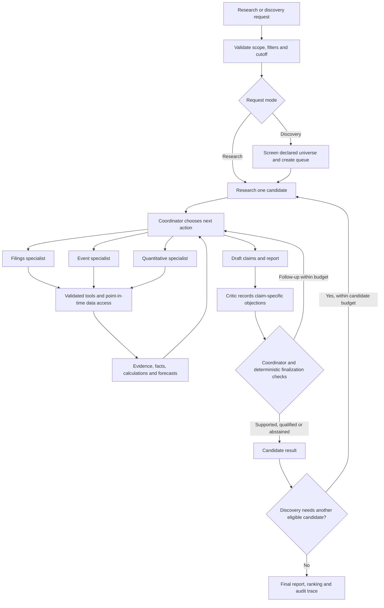

> Archived on 27 October 2026. Historical design/review context; it may describe unimplemented behavior. For current guidance use [Start](../../README.md), [Status](../../STATUS.md), [Design](../design.md) and [Sources](../sources.md).

# Implementation plan: evidence-grounded stock research and discovery

Prepared 18 October 2026, Hong Kong time. This is a proposed implementation specification, not a claim that the system has been built or evaluated.

The starting point is the final response in the [shared conversation](https://chatgpt.com/share/6ad4955b-b618-83ea-afcc-303b0e8e8767). The companion [correctness and resource review](./source_audit.md) distinguishes verified facts, design recommendations, and claims that remain unverified.

Added 19 October: the [technical blueprint](./technical_blueprint.md) specifies implementation boundaries and runtime behavior; the [Codex build playbook](./codex_build_playbook.md) provides staged coding tasks, review prompts, and model/effort recommendations.

Implementation update: the [Fieldnote application](../../README.md) now provides the custom React/TypeScript/Vite interface, FastAPI, persistent local runs, evidence inspection and synthetic teaching examples. This replaces the Streamlit choice. The full methodology below remains a research roadmap: the current app has a narrow SEC annual-facts path and bounded interpretation/critic workflow, but no validated forecast artifact, five-role coordinator, or held-out research evaluation. See the README for exact implemented boundaries and verification.

25 October alignment decision: [STATUS.md](../../STATUS.md) is the authoritative current state and remaining work order. Complete evidence correctness, bounded correction and research evaluation before the forecast/factor stage. The four-week schedule and team allocations below are historical planning assumptions, not current commitments. See the [alignment review](alignment_review_2026-10-25.md) for the code review and presentation policy.

## 1. Product and contribution

Build one application that answers two questions:

1. **Research:** “What does the available evidence say about this supported company, and what is the statistical probability that its stock outperforms SPY over the specified 20-session window?”
2. **Discovery:** “Within this declared universe, which companies satisfy these supported criteria, and what evidence supports or weakens each shortlisted candidate?”

Both modes use the same evidence, calculation, forecast, review, and reporting components. Discovery adds deterministic screening and candidate scheduling before research. It must never imply that it searched the entire US market.

The main research question is: **Does claim-specific review with targeted follow-up actions improve financial research correctness over a comparable tool-using workflow without that review, at an acceptable cost?** Forecasting is a separately evaluated component. A more convincing explanation is not evidence of a better probability estimate.

The course guideline requires a working agentic application, meaningful decisions and tool use, evaluation, runnable code, and limitations; multi-agent collaboration is optional. See the local [course guideline](../../../COMP7608B_LLM_Project_Guideline.pdf). Five logical roles are a practical organization choice, not a scientific requirement.

### Scope defaults

| Decision | Initial implementation |
|---|---|
| Universe | Five manually checked US operating companies; expand to about 30 only after the end-to-end path works |
| Coverage | USD common equities with suitable SEC filings; initially exclude financial institutions, REITs, ADR complications, and securities requiring different accounting definitions |
| Benchmark | SPY, with the same return convention and calendar alignment as each stock |
| Frequency | Daily data and a fixed daily research cutoff; no intraday forecasting |
| Research | Annual fundamentals, recent filings/events, deterministic price features, explicit risks and missing evidence |
| Discovery | Supported sector and numerical filters; deterministic probability ranking; up to three fully researched results |
| Probability | Statistical model output, unchanged by narrative agents in version 1 |
| Review | At most two critic rounds, plus independent tool/call/time budgets |
| Interface | Custom React + TypeScript + Vite web workspace over a thin FastAPI boundary and shared Python application functions |
| Deployment | One loopback Python server serves the built frontend and API; SQLite and immutable local snapshots; one active worker |

These are proposed defaults. The team size is assumed to be 3–5 from the guideline, and the schedule below assumes approximately four development weeks. The actual final deadline, available API quota, and team availability have not been established.

No brokerage integration, trade execution, portfolio optimization, reinforcement learning, model fine-tuning, general web crawler, or automatic factor discovery is needed for this outcome. General news coverage is a gated addition; filing-based event research remains part of the complete initial system.

## 2. Observable completion criteria

The application is complete when all of the following are demonstrable:

- A supported ticker produces a report with a named cutoff, numerical inputs and calculations, inspectable evidence, a model-labelled probability or explicit unavailability, material risks, and unresolved objections.
- A source or calculation result can change the next action: retrieve another filing, resolve a period mismatch, recompute a metric, withdraw a claim, or stop with a qualified result.
- Discovery shows the universe, interpreted filters, screening results, missing-data exclusions, ranking rule, investigated candidates, and why a candidate was retained or replaced.
- Every quantitative statement comes from a stored calculation or validated source fact. Every material factual claim links to an evidence span. Interpretations are labelled as interpretations.
- Date-ineligible evidence is rejected by the data layer, regardless of agent prompts. Reaching a budget limit never changes an unresolved claim into a supported one.
- Every run can be inspected through saved inputs, source hashes, tool results, claim revisions, model settings, and an action trace. Replaying saved outputs is distinguishable from a new model run.
- A frozen evaluation suite compares meaningful baselines and reports failures, coverage, cost, and latency. Negative results are acceptable; reporting them accurately is required.

## 3. Architecture and ownership



This is one bounded state machine, not five autonomous services. Initially execute roles sequentially for easier debugging. Parallel specialist calls are optional after storage writes and budgets are safe.

| Component | Owns | Must not own |
|---|---|---|
| UI / CLI | Inputs, visible interpretation of filters, progress and report display | Financial formulas or duplicated workflow logic |
| Coordinator | Next-action choice, synthesis, objection resolution, final recommendation status | Bypassing evidence rules or inventing numeric results |
| Filings specialist | Finding relevant periods, concepts and source passages | Calculating arithmetic in prose |
| Event specialist | Event extraction, event dates versus publication dates, relevance and contradictory evidence | Treating management claims as independently established outcomes |
| Quantitative specialist | Selecting supported calculations and explaining their limitations | Training new models during a research request |
| Critic | Specific errors, missing support, alternative interpretation and requested checks | Mandatory bearish arguments, direct mutation of evidence, unbounded debate |
| Data layer | Identity, timestamps, permitted source versions, normalization and provenance | Trusting an LLM's assertion that data was available historically |
| Calculation / forecast layer | Formulas, feature construction, prediction and label definitions | LLM-generated executable code |
| Finalization checks | Required fields, evidence references, status consistency, immutable forecast values | Claiming to prove the truth of narrative entailment |
| Evaluation runner | Gold cases, labels, comparisons and scoring | Revealing answers to agents |

Use Python, Pydantic, FastAPI, an HTTP client, SQLite, and React/TypeScript/Vite for the initial application. Add pandas/NumPy, scikit-learn, HTML parsing and an exchange-calendar library when the corresponding research/forecast stages are implemented. Pin tested dependencies. Store source payloads as ordinary immutable files and run metadata in SQLite. Add Parquet if price/history volume warrants it; a vector database is not required for this corpus.

Start retrieval with filing section selection and SQLite full-text search over normalized chunks. Attach section/table identifiers and original text spans. Add embeddings only if held-out retrieval failures justify them. Native typed tool calls plus a plain Python state machine are sufficient; adopt LangGraph only if checkpoint/resume complexity makes it cheaper than the existing implementation.

Suggested repository shape, with modules created as their feature is implemented:

```text
src/research_assistant/
  contracts.py
  application.py          # shared research/discovery entry points
  workflow.py             # states, budgets and transitions
  agents/                 # role prompts and typed decisions
  data/                   # SEC, prices, identity, source store
  tools/                  # retrieval, facts, metrics, screening
  forecast/               # features, labels, training, prediction
  review.py
  reporting.py
  api.py                  # thin validated HTTP boundary
  cli.py
evaluation/               # manifests, runner, scoring, adjudication
tests/                    # invariants and integration fixtures
data/                     # cached inputs; redistribution rules apply
artifacts/                # reports, frozen forecasts, evaluation results
frontend/                 # React + TypeScript + Vite workspace; input/output only
```

Do not introduce generic provider interfaces or a plugin platform for one implementation. Keep provider-specific logic in the relevant data module and normalize at that boundary.

## 4. Data contracts and invariants

Use stable internal IDs rather than ticker strings as record keys. A ticker may change or refer to more than one listing. A CIK identifies a filing entity, not necessarily a unique tradable security. Verify security-to-issuer mapping for the small supported universe and version it.

| Record | Required fields |
|---|---|
| ResearchRequest | run ID, mode, security/universe ID, cutoff in UTC, target definition version, supported filters, budget, fresh or replay mode |
| SourceDocument | source ID, URL, issuer/security links, document type, publisher, published/accepted time, time precision, first-seen time, retrieval time, version/hash, permission metadata, stored content reference |
| EvidenceSpan | evidence ID, source ID, exact text/table cell location, section/page where available, extracted content, extraction version |
| FinancialFact | fact ID, concept and original taxonomy tag, value, currency/unit/scale, instant or duration period, start/end, fiscal label, consolidated/segment scope, accession, evidence ID, availability time |
| Calculation | ID, named formula/version, input fact IDs, normalized inputs, output/unit, validation results, status and missing-data reason |
| Claim | ID/version, actual statement, fact/calculation/interpretation type, security, period, evidence/calculation IDs, materiality, verification state, dependencies |
| Objection | ID, claim ID/version, issue type, rationale, evidence or requested check, severity, disposition, resolution evidence, round |
| Forecast | ID, security, cutoff, issue time, anchor/end sessions, horizon, benchmark, return convention, p0, model version, feature/snapshot hashes, status |
| RunEvent | run ID, sequence, role, action, validated arguments, tool result reference, concise action rationale, timestamps, token/cost usage, error |

Important invariants:

1. **Evidence references resolve to stored content.** A URL alone is insufficient because pages can change.
2. **Availability is different from reporting period.** A quarter ending in March does not make its later filing available in March.
3. **Retrieval time is not historical publication time.** A filing downloaded today can be valid historical evidence if the archived version and original availability are established. Conversely, today's mutable webpage is not made historical merely by displaying an old article date.
4. **Source versions remain separate.** A later amendment cannot silently overwrite the version used for an earlier cutoff.
5. **Calculations consume facts with compatible definitions.** Incompatible or missing inputs return a typed failure, never zero or a plausible substitute.
6. **Forecasts are immutable.** Corrections create superseding records and retain the original. Resolution outcomes are stored separately.
7. **Run isolation is explicit.** A request cannot read another run's later evidence or settled outcomes through shared conversation memory.
8. **Status dimensions remain separate.** Report support, forecast availability, and screening eligibility are not a single confidence score.

Use a database transaction to reserve a run's next action and budget, then append its result once. A stable action ID prevents duplicate results after retries. The single coordinator writes authoritative state; specialist results are proposals. This is sufficient for concurrent UI requests without distributed infrastructure.

## 5. Data ingestion and financial correctness

### 5.1 Filings and facts

Use SEC submissions metadata, archived filing HTML, and XBRL company facts. The SEC provides unauthenticated JSON access, but its aggregate fact APIs cover standard taxonomy/entity-wide facts and do not replace all filing context. Its calendar frames can contain differing reporting periods. [SEC API documentation](https://www.sec.gov/search-filings/edgar-application-programming-interfaces).

Implementation procedure:

1. Resolve a supported security to its verified issuer identity.
2. Enumerate filings and establish availability from acceptance/dissemination metadata. Use a conservative availability policy and record timestamp precision; if only a date is reliable, exclude it from same-day decisions or assign a documented next-session availability rule.
3. Select the latest eligible filing for the requested task, retaining accessions and raw versions. Restrict all subsequent evidence retrieval to eligible sources.
4. Normalize standard facts but retain original tags, periods, units and source context. Maintain a reviewed mapping for the supported companies; missing custom concepts trigger filing-table retrieval or explicit unavailability.
5. Resolve multiple observations using period, concept, context, source version and cutoff. Never use simply “the last value in the JSON array.”
6. Verify key values against the archived filing table. Save that location for the report.

Cache requests and identify the client with a legitimate contact-bearing user agent. Apply a shared request limiter below the SEC's stated ceiling and bounded backoff for throttling. [SEC developer access guidance](https://www.sec.gov/about/developer-resources).

Recommended initial metrics:

| Metric | Calculation and safeguards |
|---|---|
| Revenue growth | Revenue(current comparable fiscal year) / revenue(prior fiscal year) − 1. Missing/zero denominator is unavailable; flag definition changes and unusual fiscal-year lengths. |
| Operating margin | Operating income / revenue for the same duration, currency, accounting basis and scope. |
| Margin change | Current margin minus prior margin, displayed in percentage points. A move from 10% to 12% is +2 pp, not +2%. |
| Operating cash flow | Reported flow for the explicitly named period, with original context retained. |
| Free cash flow | OCF minus positive capital-expenditure outflow under a documented definition. Label it a derived, non-standardized measure; do not equate it with issuer-adjusted FCF. |
| Cash and debt | Balance-sheet instant values with explicit included components. Do not sum overlapping debt tags or include leases without declaring the definition. |

Annual periods are the first supported path. Quarterly/TTM support comes after correctness tests: cash-flow statements may contain year-to-date flows, so consecutive YTD values require subtraction to obtain standalone quarters. Annual minus nine-month flow can derive Q4 only with compatible versions and definitions. Do not subtract balance-sheet instant values to create a quarterly balance, or sum EPS to derive annual EPS without addressing share-weighting effects.

Support GAAP comparisons first. Preserve non-GAAP labels when quoting company statements. Source reliability and truth differ: a company press release proves that management made a claim, not that its forecast will occur.

### 5.2 Events and news

The initial event specialist reads eligible 8-Ks, exhibits, and dated issuer announcements included in the local corpus. Extract event type, entity, event date, publication time, quoted facts, management interpretation, and possible relevance. Identify conflicting evidence explicitly.

Add one external news provider only after a small access test proves historical coverage, timestamp semantics, content availability, licence compatibility, and affordable volume. Do not assume a current news endpoint supplies the past. Preserve article versions and group syndicated/near-duplicate stories so five copies are not counted as five independent confirmations. A headline-only record can support a statement about that headline, not unobserved article contents.

No eligible article found means “no eligible evidence found in these sources,” not “no news exists.” Exclude mutable or insufficiently timestamped news from historical experiments; it can still be used in a clearly labelled current-information report.

### 5.3 Prices and universe

Start a feasibility test with one daily-price provider. yfinance is a practical educational prototype candidate, but its documentation describes it as unofficial and points to restrictions on underlying data use. Do not promise production reliability or redistribution rights. [yfinance documentation](https://ranaroussi.github.io/yfinance/).

Freeze downloaded raw closes, adjustment fields, dividends, splits, retrieval times, timezone/calendar metadata and provider settings. Explicitly configure adjustment behavior instead of accepting library defaults. Verify a split and a dividend case by hand. Never double-adjust a series. Retrospectively adjusted price levels are not historical executable prices.

For return features, use within-window consistently adjusted returns and avoid absolute retrospectively adjusted price-level filters. For historical price/liquidity thresholds, use the appropriate raw price/volume and corporate-action convention. Missing sessions, halts, delistings and ticker changes require a defined outcome; never silently forward-fill a delisted stock or drop losing observations.

A present-day selection of 30 surviving companies can support a bounded case study, not a survivorship-free historical market-wide result. Either obtain point-in-time universe membership/delisting coverage or state this limitation. Store the chosen universe and its selection rationale before evaluating outcomes.

## 6. Forecast specification

### Target and timing

Adopt the following explicit convention for version 1; it fills a gap in the earlier response rather than claiming that response specified it.

- Cutoff `t`: 17:00 America/New_York on a trading day, converted with timezone-aware code. Features use only the completed session and eligible evidence at that cutoff.
- Anchor `e`: the close of the next exchange trading session after `t`.
- End `h`: the close 20 exchange sessions after `e` — exactly 20 close-to-close return intervals, not 20 calendar days.
- The forecast must be recorded before `e`; a late live result is marked missed, not silently moved to a new target. Arbitrary intraday requests use the most recent completed supported cutoff and display it.
- `TR_i(e,h)` and `TR_SPY(e,h)` are consistently defined dividend/split-adjusted return proxies from one frozen data convention.
- Outcome `y = 1` if `TR_i(e,h) − TR_SPY(e,h) > 0`, otherwise `0`. Exact ties are non-outperformance. Unresolved or unmeasurable outcomes are not assigned zero.

This deliberately leaves a preparation interval between the information cutoff and measurement anchor. It avoids scoring returns that occurred before the report could be issued. It is a forecast evaluation convention, not a simulated fill or trading-performance claim. Explain the anchor/end dates in the UI; “20 days from now” would be misleading.

If the team prefers a next-open target, change the target version, datasets, labels and all baselines together; first verify adjusted-open semantics. Do not mix next-open and close-to-close labels.

### First model

Use a pooled, regularized logistic regression over the supported universe, with a compact price-only feature set: 5/20/60-session returns, relative returns versus SPY, 20-session volatility, distance from a trailing moving average, and a trailing volume ratio. Predefine exact windows and missingness rules. Fit transformations on the training partition only. Exclude entity IDs as predictive features initially.

Price-only features make the statistical baseline tractable while filings support the research report. This is a deliberate division of work. The prose must not suggest that an event changed the probability when the model did not consume it. The model can be unhelpful; the evaluation must be allowed to establish that.

Compare against 0.5 and a training-only empirical base-rate probability. Optional calibration requires a distinct, earlier calibration block. Do not automatically calibrate on the test set or assume logistic regression is calibrated. The [scikit-learn calibration guide](https://scikit-learn.org/stable/modules/calibration.html) explains why probability scoring and calibration are related but distinct.

### Time-separated evaluation

1. Build rows with feature cutoff, label start, label end, security and target version.
2. Split by calendar cutoffs across all securities, not randomly across rows or individually by ticker.
3. At every model-fitting cutoff, admit only training labels whose outcomes were already observable before that cutoff. Exclude overlapping future label windows across training/validation/test boundaries.
4. Use expanding-window validation on earlier blocks to select the small model configuration. If calibrating, ensure calibration outcomes are also mature before test predictions.
5. Freeze the pipeline before the final chronological test. Keep a manifest of all attempted models, features and prompts.
6. For overlapping 20-session labels, report date-block uncertainty and a non-overlapping-date sensitivity analysis. Thirty stocks on one date do not create thirty independent market histories.

`TimeSeriesSplit` provides useful building blocks, including a gap, but a flattened multi-stock panel needs a date-group splitter and explicit label-end checks. A gap of 20 rows is not necessarily 20 sessions. [TimeSeriesSplit documentation](https://scikit-learn.org/stable/modules/generated/sklearn.model_selection.TimeSeriesSplit.html).

Primary score: `Brier = mean((p0 − y)^2)` on resolved, eligible forecast cases. Also report log loss, reliability plots with bin counts, discrimination where appropriate, sample sizes, base rates and coverage. State the Brier convention explicitly (binary mean squared probability error, range 0–1). Lower Brier alone does not prove better calibration.

If two workflows return the same `p0` on identical cases, their Brier scores are identical. If they abstain on different cases, report common-case scores and coverage; do not mistake selection for improved probabilities.

Start a prospective append-only log as soon as the baseline works. Freeze the forecast before its anchor and keep later outcomes in a separate table. Historical evidence filtering cannot erase later-event knowledge inside an LLM. Historical report tests therefore assess source-grounded task quality; they do not establish clean out-of-time LLM investing skill. Prospective results remain provisional until enough windows resolve.

Version 2 may add LLM-extracted, timestamped event features to a separately trained model, or compare an explicit adjusted probability `p1`. Require a new frozen experiment and retain `p0`. Do not add arbitrary sentiment bonuses to probabilities.

## 7. Agent workflow and review protocol

### Typed tools

Expose narrow functions such as `resolve_security`, `list_eligible_filings`, `search_evidence`, `get_fact`, `calculate_metric`, `get_price_features`, `get_forecast`, and `screen_universe`. Every result carries IDs, cutoff, source version, warnings and typed status: `ok`, `missing`, `incompatible`, `stale`, `rate_limited`, or `failed`.

A model chooses a tool and valid arguments; the application checks authorization, source eligibility, numerical bounds and budget before execution. Do not provide arbitrary Python, SQL, shell execution, broker tools, or unrestricted outbound URLs to the research agent. Retrieved text is data, never authority to change policy or call a tool.

### Workflow states

`validated → collecting → drafting → reviewing → following_up → finalizing → completed`

`failed`, `cancelled` and `budget_exhausted` are operational outcomes. A completed report separately carries `supported`, `qualified` or `abstained` status. A forecast separately carries `available`, `unavailable`, `pending_outcome` or `resolved` as applicable.

The coordinator selects actions using missing requirements, calculation failures and open objections. It must be able to justify an action with a short reference to an unresolved item; saving private chain-of-thought is unnecessary. A duplicate action with no new inputs should not consume another expensive call.

Begin with proposed caps of two review rounds, 12 LLM calls and 20 tool calls per named-stock investigation. Allow at most five deep investigations for a three-result discovery request. Set wall-time and token ceilings from the week-1 measurement and the team's actual quota; these figures are starting limits, not measured performance claims. Retries count toward the same budgets.

### Claim-specific review

The critic receives the draft claims and evidence packet, not a command to oppose the thesis. It may return no objections. An objection must name a claim version and an issue: unsupported inference, contradictory evidence, wrong period/unit/entity, arithmetic error, stale source, misleading certainty, or a material missing risk.

The coordinator records one of these outcomes:

- **Defended:** evidence addresses the objection; the claim remains, with the supporting check.
- **Corrected:** a new claim version and any dependent calculations/report sections are produced.
- **Withdrawn:** the unsupported statement is removed; dependent conclusions are reconsidered.
- **Unresolved:** the remaining issue and its impact are visible.

The critic cannot resolve an objection merely by agreeing with the coordinator. The record must identify the supporting evidence or calculation. Closure checks validate record consistency, but semantic support still needs model/human assessment; deterministic checks do not prove entailment.

Stop early when required evidence is complete and no material objection needs another feasible action. Stop at budget limits with appropriate qualifications. Track objection IDs, not counts; track whether repeated checks produced new evidence. A resolved objection on an old claim version does not automatically validate a revised claim.

A report may preserve supported facts while abstaining from a synthesis. If an unresolved issue only affects an optional comparison, qualify that section rather than suppressing everything. If it affects the central conclusion or identity/cutoff correctness, abstain from that conclusion. Missing fundamental evidence need not invalidate an independently valid price-only forecast; show the two statuses separately.

## 8. Discovery behavior

Interpret natural language into a bounded `ScreenSpec`: universe, supported sector, revenue-growth threshold, operating-margin threshold, positive-FCF condition, top-k and explicit ranking rule. Show this interpretation before or alongside execution. “Cheap” or “safe” is not a supported numeric filter without a definition; ask for clarification rather than inventing one.

Initial ranking is descending `p0` among eligible securities with available forecasts, with a stable security-ID tie-breaker. Do not disguise an LLM's narrative enthusiasm as a calibrated ranking score. If forecasts are unavailable, show those securities separately rather than mixing in an unrelated rank.

Screen cheaply over cached normalized facts. Each filter yields pass, fail or unknown. Missing data never counts as pass. Research queued candidates in rank order; if investigation discovers a filter violation, update the fact with provenance, record exclusion, and advance to the next candidate within the cap. A qualified report can remain eligible if its unresolved issue does not undermine a hard filter or the selection rationale.

Display the number screened, eligible, investigated, rejected, qualified and returned. Return fewer than k when evidence or budget is insufficient. Every final candidate must satisfy all hard filters using validated facts; this is a deterministic acceptance test.

Evaluate discovery against the same screen-and-rank pipeline without agent review. Measure constraint satisfaction, exclusion/replacement correctness, evidence completeness and cost. Forecast ranking outcomes are secondary: compare top-k outperformance rate and mean excess return on common resolved dates against the statistical screen-only ranking, without presenting overlapping selections as a tradable portfolio.

## 9. Evaluation plan

### Cases and gold labels

Before prompt tuning, create a development set and reserve a separate held-out set. A workable proposed allocation is 20 development cases and 60 held-out cases: 30 named-stock research tasks, 15 discovery tasks and 15 robustness/failure tasks. Keep natural errors and deliberately injected defects labelled separately. These are workload targets, not a statistical power guarantee.

Include clean cases where the critic should change nothing, conflicting periods, wrong units, stale/missing filings, restatements, wrong ticker mappings, duplicated news, invalid citations, failed APIs, impossible filters, prompt-framing changes and malicious instructions embedded in source text. Do not put gold answers in tool responses or retrieved metadata.

Freeze each case's eligible evidence, expected calculations, material claims/risks, permissible follow-ups and acceptable final statuses. A second group member checks gold annotations without seeing the system answer. Independently double-label a substantial subset and adjudicate disagreement; record whether ambiguity is in the data or the rubric. Keep final labels away from developers tuning the prompts.

FinQA is useful as a separate numerical-reasoning component test because it supplies financial text/tables and reference programs/answers. It does not evaluate discovery, whole-document ingestion or forecast accuracy. Keep its gold programs and support indices out of model input. [FinQA dataset](https://github.com/czyssrs/FinQA).

### Comparisons

| Condition | Purpose |
|---|---|
| A: deterministic facts/calculations + report template | Establish what ordinary software already solves |
| B: one tool-using agent with bounded self-check | Strong application baseline with comparable tools and budget |
| C: role-based workflow without critic | Isolate role specialization from review |
| D: role-based workflow with critic and follow-up | Proposed full system |

Hold source availability, cutoff, base model/settings, task set and maximum budget constant where applicable. Also report actual compute; equal ceilings are not equal spend. For the isolated review experiment, start from the exact same saved draft/evidence and compare: no revision, coordinator self-review, and critic-guided revision with comparable extra allowance. Separate improvement from added retrieval from improvement due to the reviewer by reporting tool usage and, if feasible, an evidence-fixed variant.

### Metrics

| Dimension | Measurement |
|---|---|
| Factual grounding | Supported material claims / assessed material claims; also coverage of required facts so omission cannot win |
| Numeric correctness | Correct normalized value, formula, period and unit; predefined display-rounding tolerance |
| Review benefit | Incorrect→correct changes, correct→incorrect changes, valid-objection precision, missed material errors, unnecessary withdrawals |
| Risk coverage | Case-specific material risks identified with support / gold material risks; a generic risk list gets no credit |
| Abstention | Whether abstention/qualification matches the case rubric; coverage and correctness at each coverage level |
| Agent behavior | Useful follow-up selection, recovery success, duplicate actions, termination within limits |
| Discovery | Hard-filter satisfaction, correct exclusion/replacement, declared-universe coverage |
| Forecasting | Brier, log loss, reliability with counts, base-rate comparison, coverage and resolved sample size |
| Operational | Median/p95 latency, calls/tokens/cost per completed and attempted task, cache/fresh mode, failure rate |

Use blinded human assessment for semantic citation support and risk coverage, supported by deterministic checks for IDs/numbers/timestamps. An LLM judge may triage cases but is not sole ground truth. Bootstrap paired task-level differences for research metrics, keeping claim clusters together; use date blocks for forecast dependence. Small-sample intervals should be labelled exploratory. Run repeated trials on a representative subset to quantify stochastic variability.

Release gates are engineering checks: no known cutoff bypass, all mandatory boundary tests passing, both modes work, failure paths are explicit, all material claims have inspectable references, and evaluation is reproducible. Scientific claims about superior correctness or forecasts require actual results; do not set profitability or a fabricated accuracy number as the definition of completion.

## 10. UI, reproducibility and demonstration

Show one research page and one discovery page. Each report has:

- Scope, issuer/listing identity, cutoff, source coverage and freshness.
- A probability card labelled as the statistical model's estimate, with benchmark, anchor/end dates and target definition.
- Financial metrics with formula/input drill-down.
- Supported observations, interpretations and material counter-evidence.
- Claim→objection→tool action→resolution history.
- Remaining limitations and separate report/forecast statuses.

Provide an event timeline of actions and concise rationales, not an internal reasoning transcript. Export Markdown/HTML plus machine-readable JSON. Sanitize retrieved HTML, keep API keys server-side, redact secrets in logs, restrict network sources, and cap payload sizes and tool arguments. Source documents cannot request secret disclosure or policy changes. AgentDojo provides relevant evaluation precedent for testing task utility alongside prompt-injection resistance. [AgentDojo](https://arxiv.org/abs/2406.13352).

Use three explicit modes: fresh retrieval and inference; fresh inference over frozen evidence; replay of a saved run. Display the selected mode. The demo should execute the agent over cached source evidence to reduce network fragility, and retain a saved replay as an openly labelled fallback.

Suggested live demonstration: screen a small universe, open a candidate, show a deliberately injected annual/quarterly mismatch in a test draft, let the critic request a comparable period, recalculate, revise the claim and reconsider eligibility. Label the injected defect as a test fixture. Follow with a clean case that remains unchanged and a missing-data case that qualifies or abstains. This shows correction, restraint and graceful failure.

## 11. Ordered implementation backlog and schedule

| Phase | Work packages and owner | Depends on | Evidence of completion |
|---|---|---|---|
| Days 1–2 | Product/evaluation owner freezes scope, forecast target and ten gold cases; data owner tests five issuers and price history; integration owner verifies chosen LLM tool calls | None | One manually checked evidence packet, provider feasibility table, budget estimate, fixture schemas |
| Week 1 | Data/tools owner builds identities, snapshots, cutoff gate, fact selection and initial metrics; forecasting owner builds price features, labels and base-rate/logistic baselines | Feasibility | Unit/period/cutoff fixtures pass; one reproducible numeric report; prospective log begins as soon as model is usable |
| Week 2 | Controller owner builds coordinator, specialists, typed tools and named-stock path; interface owner adds report view; evaluation owner implements conditions A/B | Contracts and tools | Research works with real tools, meaningful follow-up, unavailable data and bounded stop |
| Week 3 | Review owner implements objections/revisions; controller adds discovery queue/replacement; forecast owner finalizes chronological splits | Named-stock path | Three retained/replaced candidate scenarios; unchanged clean case; critic benefit/damage logged; condition C/D runnable |
| Week 4 | Freeze prompts/configs; run held-out evaluations; fix operational failures without retuning on test answers; prepare demo and report | Complete system | Results tables, limitations, replay bundle, setup command, offline-fixture smoke test |

Five workstreams: data/tools; controller; review; forecasting/evaluation; UI/integration. With four people, combine controller and review. With three, combine data with forecasting, controller with review, and UI with evaluation coordination; cross-check each other's gold labels. Avoid assigning one isolated agent to each person without shared contracts and integration ownership.

Minimal verification backlog:

1. Annual/quarterly and USD/millions mismatches rejected before arithmetic.
2. Restatement after cutoff cannot affect the earlier result.
3. Late news and a forged earlier date on a mutable page cannot enter historical evidence without provenance.
4. Next-session and 20-session endpoints handle weekends, holidays and daylight saving time correctly.
5. Split/dividend fixture produces the expected return convention, without double adjustment.
6. No training label ends after its model-fitting cutoff; all tickers on a date share the same split.
7. Critic can return no objections; valid and invalid objections receive distinguishable outcomes.
8. Unresolved material objection survives budget exhaustion in the report.
9. Same probabilities and same cases yield identical Brier scores across report configurations.
10. Discovery never returns a hard-filter failure and never silently relaxes an unknown criterion.
11. Duplicate retries, concurrent runs and cancellation do not corrupt another run or its forecast log.
12. Retrieved prompt injection cannot change cutoff, tool allowlist, or disclose API keys.

Compute cost before committing to the full experiment: sum input tokens × input rate, output tokens × output rate, and data/tool fees across conditions and repeats. Use observed week-1 calls and token sizes, not a guessed dollar estimate. Reduce evaluation breadth or optional news/model experiments if quota is insufficient; retain the core ablation and gold-case quality.

## 12. Priorities and scope cuts

**Build first:** evidence provenance, cutoff enforcement, period-aware numerical tools, one complete research path, credible statistical baseline, claim-specific review, discovery reuse, frozen evaluation.

**Useful next:** duplicate-news grouping, stronger retrieval if measured necessary, prompt-framing robustness, prospective resolution dashboard, additional sectors after accounting support.

**Defer:** broad news integrations, macro factors, vector database, large agent teams, arbitrary code execution, price targets, portfolio performance and trading. If macro variables are later introduced, use historical vintages rather than today's revised values; [FRED/ALFRED real-time periods](https://fred.stlouisfed.org/docs/api/fred/realtime_period.html) provide the relevant concept.

If time is short, keep five companies, filing-based events, annual metrics, the simple statistical model, and both user modes. Cut universe breadth and optional sources before cutting provenance, failure handling or evaluation. If the model fails to beat the base rate, report that result and keep the independently useful research assistant.

Before development, the team only needs to confirm its actual final deadline, workstream owners, available model quota, and permitted market/news data access. Those choices affect capacity; they do not require redesigning the core workflow.
