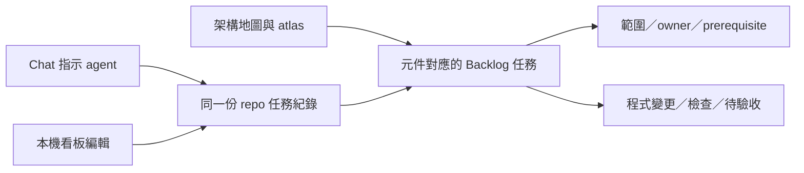

# Fieldnote 開發可視化與 agent 工作追蹤計劃

狀態：**規劃完成；尚未安裝、遷移、派工或實作**。日期：2026-10-31，Asia/Hong_Kong。

使用者已選擇：專案內的本機視覺面板，資料跟 Git 保存。新增／移除希望兼顧 chat 指示與面板操作。本計劃管理開發中的架構、工作與驗收，不遷移研究 runtime。

## 1. 建議與選擇理由

**先在隔離副本驗證 Backlog.md + Groma.md；以 Backlog.md 作任務來源，Groma 通過相容性檢查才接入。保留現有 atlas 作已檢查的架構參考。**

不先自製任務編輯器、寫入 API 或另一份 project-state JSON。現成工具已提供大部分所需行為，維護兩套狀態／編輯規則反而會增加黑箱。

| 選項 | 對本專案的適合程度 | 決定 |
|---|---|---|
| 現有文件 + atlas | 已有任務與圖，但缺少連動的開發操作 | 保留並接入 |
| Backlog.md | Git repo 內 Markdown 任務、本機看板／編輯、依賴、AC、CLI 與可選 MCP | 優先 pilot；可獨立使用 |
| Groma.md + Backlog | 本機架構地圖、任務對應元件、來源與變更、draft architecture | 最貼近需求，但仍是 early prototype，須先驗證 |
| 自製本機管理系統 | 能定製，但要自己維護資料、UI、寫入安全與同步 | 現階段不做；不能因 pilot 失敗就自動擴建 |
| LangChain／LangGraph／LangSmith | 主要管理／觀察研究程式的執行，不是 coding agent 的開發交付 | 本計劃不採用；runtime tracing 日後獨立評估 |
| 外部 GitHub Projects／Notion | 會新增另一個需同步的 tracker | 目前不引入 |

「看得到」的成功條件是能從同一組資料回答：模組如何連接；每個模組的工作與 owner；甚麼可開始／被甚麼阻擋；哪些只是程式完成、哪些已驗收；本次 agent 是否偏離範圍；改功能會影響哪些依賴。

## 2. 已核對的能力與未確認項

以下為 2026-10-31 官方文件所述，**不是本機實測結果**：

- [Backlog.md README](https://github.com/MrLesk/Backlog.md)：任務是 repo 內 Markdown；`backlog browser` 提供本機看板、建立／編輯、AC checklist、archive，CLI／Web 共用檔案；支援 Windows、MIT、local-first。可只用 CLI instructions，MCP 不是必要設定。
- [Backlog 設定](https://github.com/MrLesk/Backlog.md/blob/main/ADVANCED-CONFIG.md)：可自訂 statuses；`autoCommit` 預設 false；`remoteOperations` 預設 true，接入時須明確關閉；初期亦關閉 cross-branch task merging，避免把其他 branch 的任務誤當現在狀態。
- [Groma README](https://github.com/MrLesk/groma.md)：C4 架構保存為 Git 中的 Markdown；可讀 Backlog tasks 並 pin 到元件；有 source changes／drafts。安裝 scanners 後掃描可離線、用 deterministic analysis、不呼叫 AI。工具明確標為 early prototype。
- [Groma task links](https://github.com/MrLesk/groma.md/blob/main/docs/agent-instructions/backlog.md)：planned references 與 modified files 連到元件；檔案必須已有架構 owner 才能對應。不是自動讀懂 chat 或可靠歸屬所有編輯。
- [Python scanner](https://github.com/MrLesk/groma.md/blob/main/docs/scanners/python/index.md)：支援 Python 與部分 FastAPI HTTP evidence，但一般 Python call targets 保持 unresolved；不能把掃描線當成完整 call graph。

尚未確認：Windows packaged binaries／scanner 安裝、此 repo 的 scanning exclusions、Python/React 跨層關係品質、自訂 final status 和 task overlays、dirty baseline／多作者 diff 行為、UI conflict／archive dependency 行為、實際資源用量。V1 專門檢查它們。

本機 PATH 查到 Node/npm，沒有查到 backlog、groma 或 bun。不需要先裝 Bun，也不應在計劃階段自動 global install 或修改 client MCP 設定。

## 3. 現有專案如何接入

已讀 [STATUS](../STATUS.md)、[Design](../docs/design.md)、[Workstreams](../docs/workstreams.md)、[Integration](../docs/integration.md)、[C1 handoff](../docs/c1-handoff.md)、[C0 checks](../verification/integration/checks-20261031.json) 和 [18 圖 atlas](../.archify/index.html)。

本次觀察 HEAD 為 `2c7f20378ae0667d9d3336758854234e9cacf211`；checkout 有既存未提交的 C1／文件／圖表工作，不是 clean feature baseline。不能用這個 HEAD 的新 worktree 冒充包含 C1 的現況。

遷移時必須保留的狀態：

| 項目 | 正確呈現 |
|---|---|
| C1 filing／fact／calculation | 程式已交付；不要再次分派同一實作 |
| C1 / 3.1 另一人檢查 | pending；不能用 agent 或 software checks 代替 |
| C0 / 0.2 C1 integration | pending；後續 runtime consumers 的 gate |
| C3、C4 | 保留原有 contract／baseline 進入條件 |
| C5 / 8.1、C7 / D1 | 文件記錄為可指派，不能因此顯示成已派工／執行 |
| C6 / U1 | partial；build pass 不等於 UI 已完成 |
| C8–C10 | extension／optional，未選用不能自動列成 core 必做 |

這是本次文件與程式檢查的結論，不是重跑全部測試或即時查詢所有 chat 的結論。遷移先不重構 app、不改資料庫、不跑 live research。

## 4. 使用時會看到甚麼

- **架構視圖：** 少量清楚的責任元件，選一個看來源、相關任務與影響；不把整個 Graphify 大圖塞進首頁。
- **工作視圖：** 現在做甚麼、待驗收甚麼、依賴和阻擋原因；顯示 task-level status，不用總完成百分比假裝量化不同工作量。
- **驗收視圖：** task brief／AC、預期檔案、實際 changed files、測試結果、證據位置、review decision；「完成研究程式」不代表研究結論正確。

Groma 若通過，提供原生架構／task overlay；未通過則先用 Backlog + 現有 atlas，接受兩個互相連結的視圖。不能宣稱未通過的功能已存在，也不立刻做 custom replacement。

## 5. 一份任務來源，避免重複管理

Backlog 通過 V1 並完成逐項核對後，其 task files 成為**可變任務狀態的唯一來源**。

| 資訊 | 接入後責任 |
|---|---|
| 任務 scope、AC、owner、status、dependency、plan、handoff | Backlog task；透過 CLI／Web，後續有需要才接 MCP |
| C0–C10 原始 ID | 保留在 title／label／brief，例如 `C3 / 5.1`；Backlog 原生 ID 另用於工具連結，不強迫偽造 dotted IDs |
| workstreams | 保留 lane 邊界、assignment 規則、resource packs、依賴設計；逐項 task brief／AC 在切換時搬到對應 task，原位置留下固定連結 |
| STATUS | 產品能力與日期明確的檢查／milestone 摘要；逐 task 狀態改連到 board 或原生 export，不再雙重手填 |
| integration | 保留 dirty baseline／歷史 ownership 與共享檔案整合規則；當前 assignment 連到 tracker |
| docs/design.md | 穩定的行為、信任邊界和研究 protocol，不被圖工具重新定義 |
| groma/（若接入） | 可檢查的 live architecture records／drafts，與程式一同 review |
| .archify/ | 保留已檢查的日期快照與詳細流程圖，不覆寫既有 evidence bytes |

先試 5–8 個代表性 task：C1 已實作項、獨立 review、C0 gate、C3 待解鎖、C5 可指派和 optional 工作。試用期間 Backlog 明確標記 pilot，原有文件仍是權威；通過才一次 cut over 所有保留範圍的 task，不能長期雙寫。

缺少歷史 reviewer／版本綁定時標「未記錄」，保留既有完成結論，不捏造，也不把全部舊工作自動重新開工。`tasks/todo.md` 只追蹤本計劃 V1–V5；正式遷移後把其尚未完成項移入同一 tracker，留下交付索引。

## 6. 讓 agent 保持方向的工作協議

沿用現有 C0 管理，不另外建立「每步自動開多個 agent」的系統。根目錄加一份短 `AGENTS.md`，引用同一 tracker 與現有規則；其他 client 必須明確讀取同一規則，不能假設都自動支援。

| 時點 | 最小要求 | 可檢查的輸出 |
|---|---|---|
| 開工 | 讀一個 task、AC、prerequisites、owner、dirty baseline；記錄本次 plan／預期檔案 | 有 task ID、開始條件與範圍，不能只說「繼續完成專案」 |
| 修改時 | 需要擴 scope／改 shared contract 時，先提出具體影響；讓 task 的 references／changed files 反映實際改動 | 能看出 work 落在哪些元件；不把 reference 當授權 |
| 交接 | 寫實際行為、changed paths、focused checks、證據、限制；先到 Implemented／待驗收 | 不因 agent 自己寫 Done 就被當成 accepted |
| 驗收 | 由既有 C0／指定 reviewer 對照 AC 和實際 evidence；3.1 的另一人檢查要求不變 | Accepted／changes requested 有依據，使用者不用重讀全部 code 才知缺甚麼 |

建議 pilot statuses 為 `Planned / In Progress / Implemented / Accepted`；Blocked／Deferred 有可見原因或標籤。須實測自訂 final status 與 dependency／Groma 的語意一致；如不一致，保留原生 statuses，改用明確的「implementation」和「acceptance gate」task，不能硬改 vendor。

開工／交接的範圍核對必須比較 relevant entry 和 exit 檔案 hash／status，包含 untracked、刪除與改名。只與 HEAD 比較會把既存 dirty C1 工作誤算到新 task。多人改同一檔案則標歸屬不確定，由 C0 處理；不自動 reset／stash／覆寫。

先用原生 task plan／notes／references／modified-file／final-summary；若 native 功能缺少 entry／exit scope proof，再加**一個小型 read-only checker**，透過原生 versioned JSON 讀 tasks，產出 `verification/development/<task>/<timestamp>.json`。不要另造 task DB、寫入 API 或狀態引擎。正式 receipt 包含必要 input hashes／entry 摘要，不能只連 ignored temp。

原生看板不是強制授權系統；拖卡到 Accepted、task assignee 或 map 上的 busy 標記都不是安全保證或 live process telemetry。未登記的 chat 顯示未連接／未知。scope checks 偵測範圍偏離，不證明語意正確，也不能阻止一個無視規則的 agent 改檔。

新改動使相關 code／AC 不同時，舊驗收保留為歷史，不把它當成現在的 pass。證據分清 recorded、可對上當前 inputs、以及未綁版本；tests、browser、integration、獨立來源檢查分開。

## 7. 隨時新增／移除：兩個入口，一套紀錄

- **Chat：** 你提出需求，agent 用 Backlog CLI 建立／修改 task，寫理由、AC、dependency、affected components，再實作已授權內容。
- **面板：** 你建立／修改／延後 task 或調整優先次序；agent 開工先重新讀取。若 pinned 版本不提供所需欄位，透過 CLI 修改，不 fork UI。
- **架構：** Groma 的 draft 用於討論未存在的模組／連接；新增圖形不會產生 code。重要變更先看受影響的來源、contract、task 與驗收，再決定實作。
- **移除：** 預設 defer／cancel／archive，保留 ID／理由／evidence。既有 dependency 被撤除時必須明確處理影響；不刪 research source、saved report 或 code。真正刪 code 是另有範圍／相容性驗收的實作 task。
- **變更 review：** 一般微調沿用已授權工作；產品範圍、shared public contract、資料／付費等重大選擇才交使用者決定，不讓每個欄位都變成 approval 關卡。

所有改動留在檔案與 Git diff；不 auto-commit／push。切換前讀現況，避免 chat 用舊 plan 蓋掉 UI 新改動。pilot 要實測兩個 editor 的衝突行為；若無可靠保護，採單一 writer 和修改後重讀／diff，不宣稱具備 transactions 或 role enforcement。

## 8. Pilot、安全邊界與成本

**先不在主 checkout 執行 init／scan。** 在 ignored `.tmp/visibility-pilot/` 建立隔離來源副本；按 allowlist 複製當前 `src/`、`frontend/src/`、必要 manifest 與相關非敏感 docs，記錄 hashes。副本須包含當前 C1 overlay，不能只 checkout 舊 HEAD。工具需要 Git 時建立獨立 scratch repo；其 snapshot 只識別 pilot bytes，不冒稱 project feature commit。

禁止納入／掃描／匯出：`.env`、live `data/`、`.git`、`.venv`、`node_modules`、`.tmp`、`graphify-out`、`.archify` 的複製來源、verification packet bytes、recovery copies、held-out 答案。先證明 exclusions 生效，再掃描；test fixtures 若要納入，另指定狹窄且不含 gold 的集合。

安裝使用 project-local／scratch tooling、釘選實測 release 和 scanner 版本；不使用漂移的 latest 自動更新，不改全域 Git／MCP 設定。Backlog 關閉 autoCommit、remoteOperations、cross-branch aggregation、任意 onStatusChange shell hook；不要求每個 task 建 PR。初期單一 tracker writer；現有最多兩個 implementation chats 和 C0 串行整合規則不變。

工具 web server 綁 loopback、使用與 8000／5173 不同 port；確認實際 binding，不只看 localhost URL；占用時清楚失敗，不停止別人的 server。現成 web writer 的 Origin／Host、危險 path／text、雙 editor lost-update 行為在副本試用；不能把官方 local-first 宣稱當成完整安全審查。不暴露 LAN、不設常駐開機服務、不公開 export（exports 可能含 source）。

**成本：** 官方稱兩工具為免費 MIT、本機運作；task 編輯和 deterministic scan 不需要額外 LLM call。套件／scanner 安裝需要下載；掃描／watch 有 CPU、memory、filesystem 成本；coding agent 仍會消耗正常 token。先量一次 initial scan 與 representative edit 的更新耗時／資源，再決定是否保持 watch；不加 background AI reviewer。不能承諾「完全零成本」。

## 9. 逐步交付與 go／no-go

具體 task 與驗收見 [todo.md](todo.md)。本次沒有指派 chat，也沒有安裝工具。

1. **V1：隔離相容性 pilot。** 驗證 Backlog 的雙入口／status／dependency／archive，以及 Groma 的 Python+React、task pins、draft 與 source privacy。Backlog 與 Groma 分別作 go／no-go。
2. **V2：任務狀態 cutover。** 先核對代表性項目，再逐項移入保留範圍；修改舊文件的狀態所有權，消除雙寫。C0 協調共享文件編輯視窗。
3. **V3：agent entry／handoff 協議。** 加短 AGENTS、原生 task template；先證明 native 能做的部分，只有缺口才做小型 checker。
4. **V4：架構連結與校正。** Groma 通過才接入／整理元件與 flows，與 atlas 和 source 對照；沒有通過則維持 atlas + task references，記錄缺口。
5. **V5：一個入口與真實任務試用。** 專案內釘選 tooling／單一啟動方式，用下一個已授權 task 走一次完整交付。

V1 Backlog 失敗：保留現有文件／atlas，交回具體錯誤和最小缺口；不開始大遷移。只有 Groma 失敗：Backlog 可獨立接入；需要之後再比較替代架構視圖，不能立刻重寫一個 Groma。

V2/V3 不解鎖原本 C1 acceptance；V4 的圖不能替代 C0 review。共享 runtime 的並行修改仍須等 feature-containing checkpoint；規劃／pilot 不能冒稱主 repo 已 clean 或已 commit。

## 10. 驗收案例與退出路徑

交付至少演示：

1. C1 程式已完成，但獨立 review／C0 gate 仍 pending；C3 正確顯示阻擋。
2. 同一 task 從 chat/CLI 與 UI 修改得到同一份記錄；新增 draft 不冒充 implemented。
3. 在隔離 fixture 超出 declared scope，交接能指出；原有 dirty 檔案未改時不錯算。
4. 改 code 或 AC 後，舊 proof 不能仍冒稱 current；missing／unbound evidence 明示。
5. defer／archive prerequisite 後下游不能默默當作已完成；來源／code／歷史保留。
6. 地圖的 source owner／worker／store／SEC／model 邊界與真實 code 可對照；未知 Python call 關係不亂連。
7. offline 查看、鍵盤、390px、合理更新耗時；操作不呼叫 SEC／LLM，不接觸 live store，不向外分享 source。

只跑新增 checker 的 focused tests 和工具 pilot／相關 browser checks。runtime 不改就不重跑 paid calls 或重新實作 C1；若真的改 runtime／contracts 才追加適當 regression。

接入失敗時停止工具，只退回本次 allowlisted 接入檔案的變更，原始 task／圖表／證據保留。task 是普通 Markdown，可移出工具繼續使用；source 文件可按已保存的 cutover diff 恢復。已有後續工作時用反向變更而非舊檔直接覆蓋，不自動 reset／clean。

停止條件：用一個入口回答第 1 節問題；每個工作只需原生 task 更新和必要 evidence；無長期雙寫。不要擴建成通用 agent platform、每步 multi-agent review 或新的研究 orchestration framework。

## 11. 本次規劃交付

只建立／修訂 `tasks/plan.md` 與 `tasks/todo.md`。沒有安裝、init、scan、task migration、AGENTS／MCP 修改、server、commits、worktrees、chat 派工、定時監控、live research 或 paid model run。官方工具功能仍須 V1 實測；不把這份計劃當成已接入成果。
