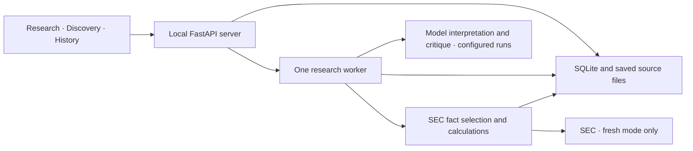

# Design and research protocol

[Start](../README.md) · [Current status](../STATUS.md) · [Sources](sources.md)

Keep one local application. Python owns evidence eligibility, calculations and run limits; model calls propose interpretations and checks. The research question is whether targeted review improves financial correctness without excessive cost or damage to correct claims.

## System at a glance

Explore the [Fieldnote system and next steps](../.archify/explainer-fieldnote-20261028-004223/fieldnote.html) for the current architecture, optional model review, connection checks and planned Discovery/correction work. This dated working-tree snapshot replaces the earlier diagram copies. Source snapshots and validation receipts accompany it; planned behavior is labelled separately.

| Responsibility | Current owner | Why it stays here |
|---|---|---|
| Accessible screens, navigation and request recovery | [frontend/src](../frontend/src/) | Presentation never authorizes tools or computes authoritative financial values |
| HTTP validation and local access restrictions | [api.py](../src/research_assistant/api.py) | One boundary for all callers; serves the production UI too |
| Run lifecycle, shared research/discovery, model calls | [application.py](../src/research_assistant/application.py) | One worker and one shared budget avoid competing workflows |
| Annual source selection and Decimal arithmetic | [research.py](../src/research_assistant/research.py) | Financial correctness belongs beside the inputs and formulas |
| Pass/fail/unknown screening | [screening.py](../src/research_assistant/screening.py) | Missing data cannot silently qualify a candidate |
| Transactions, idempotency and immutable source bytes | [store.py](../src/research_assistant/store.py) | Saved runs remain recoverable and inspectable |

No orchestration framework, vector database, broker connection or distributed worker is required. Five proposed research roles describe responsibilities, not separate services or a course requirement.

## Rules that must survive changes

| Boundary | Required behavior |
|---|---|
| Financial inputs | Match issuer, concept, unit, period, accounting basis and scope. Missing or incompatible values are unavailable, never zero. |
| Evidence time | Keep reporting period, source availability and retrieval time distinct. Later amendments cannot overwrite earlier source versions. |
| Source trust | A URL or valid schema does not prove a claim. Retrieved text cannot change policy, disclose secrets or authorize tools. |
| Review | Retain originals, unresolved concerns and resolution evidence. Reaching a limit cannot turn a claim into a supported one. |
| Discovery | Unknown inputs never pass hard filters. Return fewer candidates when evidence or budget is insufficient. |
| Presentation | Keep sources, dates, interpretations, corrections, uncertainty and partial results visible; put diagnostics behind disclosure. |

Current annual facts compare three supported revenue tags by eligible recency, reject conflicting same-accession/period values and match income by accession and duration. This narrow mapping is not a general accounting parser. Current SEC aggregates plus cutoff filters do not reconstruct every historical data vintage.

### Saved-run behavior

| API mode | Reuses | Performs |
|---|---|---|
| `replay` | Original inputs and results | Reads only; API replay can save a labelled copy |
| `frozen` | Sources, calculations, company and original cutoff | Optional new interpretation/review; old review outcomes are excluded |
| `fresh` | Supported company/universe definition | Eligible SEC retrieval, calculation and optional new review |

Synthetic sources remain labelled in every mode. Frozen discovery can change screening thresholds over the same saved company packets. No mode silently substitutes synthetic data or a saved model answer for a failed live operation.

The browser defaults model analysis off and submits `model_analysis` explicitly. Older API requests that omit it retain the previous default of `true`; replay never calls a model. Financial availability comes from metric values, independently of each company's `review_status` and `review_error`. Review status is `not_requested`, `pending`, `completed`, `unavailable`, or `failed`; legacy reports default to `not_recorded`. Missing setup/evidence and expected model errors preserve financial completion, while budget exhaustion still stops the run. Restart recovery marks pending analysis failed without changing saved figures or retrying. Completed model analysis does not establish source correctness.

Runtime, storage and API reference

One process lock protects each data directory. A SQLite transaction and unique active-run index protect submissions. Idempotency keys bind to canonical request inputs for the database lifetime; a changed request with the same key fails. The browser retains uncertain submissions across refresh and retries that same intent. Reads, reconnects and rerenders cannot start research.

On restart, unfinished runs become interrupted with saved results retained. There is no cancellation or automatic checkpoint resumption. Graceful shutdown waits for the worker. Keep the server on loopback; public hosting, authentication and multiple users are outside the current design.

| Limit | Current value |
|---|---|
| Shared discovery/research budget | 12 model calls; 20 retrieval/check actions |
| Admission deadline / token threshold | 180 seconds / 18,000 tokens |
| Model request | 45-second timeout; no automatic retries |
| SEC request | 20-second read timeout; 5-second connect timeout; 25 MB response cap |

In-flight calls may cross admission thresholds. Remote billing is not guaranteed exactly once. Persist per-call provider, requested/returned model, response ID, token counts, status and provider-reported USD cost; absent usage/cost stays unknown. Each company currently receives one interpretation/critic pass; an explicit model connection check allows at most that pair. The proposed maximum is two review rounds within the shared limits.

Model settings come from the server environment and are fixed until restart. `RESEARCH_MODEL_PROVIDER` selects OpenAI, OpenRouter or a trusted compatible endpoint. OpenRouter requires its own key and an explicit model, uses only `https://openrouter.ai/api/v1/responses`, and rejects `OPENAI_BASE_URL`, automatic model routing and online-search variants. All model requests set `store=False`; clients use `max_retries=0`. OpenRouter also sends `require_parameters=true` and `allow_fallbacks=false`. Structured output still passes the application's schema and evidence-reference validation. These request controls do not establish live compatibility, provider retention policy or research quality.

| Endpoint | Behavior |
|---|---|
| `GET /api/config` | Company/configuration information and current-session connection outcomes; no credentials |
| `POST /api/runs` | JSON plus `Idempotency-Key`; returns HTTP 202 |
| `GET /api/runs?limit=30&offset=0` | Paginated history |
| `GET /api/runs/{id}` | Persisted state and available report |
| `GET /api/runs/{id}/evidence/{evidence_id}` | Run-scoped evidence; cross-run IDs return 404 |

Use timezone-aware cutoffs and an explicit mode. Screen fields are sector, minimum annual margin as a ratio (`0.1` = 10%) and result limit 1–5. Validation errors return 422, conflicts 409, unsupported origins 403 and unsupported hosts 400. Full field definitions live in [contracts.py](../src/research_assistant/contracts.py) and the running server's `/openapi.json`.

`CompanyReport.source_limitations` separates source cautions from combined report `limitations`. `None` means a legacy record; `[]` means no source cautions. New frozen reviews remove only exact known historical review messages, preserve unknown cautions and leave original replay records untouched.

Submission recovery compares requests after applying compatible schema defaults. Older pending requests keep their original payload and key; changing the model-analysis choice under an existing key fails.

### Connections

Environment variables remain the sole configuration source; changes require restart. Connections uses `GET /api/config`, retaining legacy fields and adding separate SEC/model setup and last-attempt records. No settings-write API or browser credential storage exists. Raw endpoint URLs and SEC contact identities are not returned. Opening and refreshing Connections never calls a provider.

Connection outcomes are scoped to the current application instance and reset on restart. Only actual retrieval/review paths can record passed or failed outcomes; opening saved examples, replay, missing setup/evidence and unrelated host failures cannot establish provider access. A successful SEC response does not guarantee eligible financial coverage; a valid model review does not establish research correctness.

Explicit check buttons submit ordinary saved runs through `POST /api/runs` and reuse idempotency/recovery safeguards. The SEC check is fixed to fresh MSFT retrieval with model analysis off. The model check selects finished saved company evidence and reuses its cutoff in frozen mode; the UI labels synthetic sources. It requires a positive USD allowance and explicit consent to send evidence/incur charges with confirmation that a provider/key spending cap is set. This records authorization, not an enforceable dollar guarantee: the app cannot ensure provider billing stays within the allowance. Current provider checks are mocked; real checks remain pending identity, credentials, model and spending authorization. Later data providers belong to their data type and must retain provenance without silent fallback.

## Next implementation boundary

The [status page](../STATUS.md) owns work order. Extend existing modules only when their first real caller needs the new behavior.

| Record | Information the next milestone must preserve |
|---|---|
| Fact | Raw and normalized value, issuer, concept/tag, unit/scale, instant or duration period, scope/basis, accession, availability and saved evidence location |
| Calculation | Named/versioned formula, immutable input fact IDs, validated result or typed failure |
| Claim | Type, immutable version, evidence/calculation references and support status |
| Objection | Target claim **and version**, requested check, disposition and resolution evidence |
| Run/action | Inputs, source hashes, actual model/settings, prompt/schema versions, usage and outcomes |

Archive an independently checked filing/table packet, then implement objection → allowed check → corrected/unchanged/unresolved result. A corrected input invalidates dependent calculations and claims. Re-screen Discovery after corrections and replace an ineligible candidate within the same universe/budget. The model cannot execute arbitrary code or unrestricted URLs.

Keep operational run status separate from report support, candidate eligibility and forecast availability. A completed process does not establish financial correctness. Textual digit rejection is only a narrow output guard; quantitative claims must ultimately refer to host-owned facts/calculations.

## How to evaluate research

| Condition | What it tests |
|---|---|
| A — deterministic facts and report template | What ordinary software already solves |
| B — one tool-using agent with self-check | A meaningful application baseline |
| C — specialist roles without critic | Benefit of role organization |
| D — roles with critic and follow-up | Benefit and cost of targeted review |

Freeze development and held-out cases, eligible evidence, expected calculations, material claims/risks and acceptable statuses. Include clean cases, wrong periods/units, restatements, missing data, bad citations, impossible filters, API failures and hostile source text. Label injected defects separately. Have another person check gold labels; double-label a subset and resolve disagreements. Keep answers out of model inputs.

Hold tasks, evidence eligibility, model/settings and maximum budgets comparable; report actual spend too. For isolated review, reuse the **same initial draft and evidence** for no-revision, self-review and critic-guided revision. Distinguish gains from additional retrieval from gains from review.

Measure supported claims **and coverage**, numerical correctness, valid objections, corrections, harmful revisions, unnecessary withdrawals, material-risk coverage, justified abstention, discovery exclusions/replacements, useful follow-ups, failures, latency and actual usage. Human assessment owns semantic citation support; an LLM judge may triage, not supply sole ground truth. Use paired task-level uncertainty, preserve claim clusters and label small samples exploratory. Repeat a representative subset to expose randomness.

Passing software tests is an engineering gate. Claims of better research require these experiment results. Negative results are acceptable.

Later forecasting specification — proposed, currently unavailable

Freeze the target version before experiments. The existing proposal uses:

| Item | Convention |
|---|---|
| Cutoff | 17:00 America/New_York on a trading day; completed-session inputs only |
| Anchor / end | Next exchange-session close / close 20 exchange sessions after the anchor |
| Issuance | Save before the anchor; late output is missed, not silently shifted |
| Return | Consistent dividend/split-adjusted return proxies for stock and SPY |
| Outcome | `1` when stock return minus SPY return is positive; exact ties `0`; unmeasurable outcomes unresolved |

There are exactly 20 close-to-close intervals. Intraday requests use the most recent completed supported cutoff. Display actual anchor/end dates. This evaluates forecasts, not simulated trade fills. Changing to next-open requires a new target version and new labels/baselines.

Validate one provider, session calendar and corporate-action convention; preserve raw closes, adjustment fields, dividends/splits and retrieval settings. Check a split and dividend by hand; never double-adjust, silently drop losing/delisted observations or forward-fill delisted prices. A current selected-company universe cannot establish survivorship-free market-wide results.

Start with pooled regularized logistic regression: 5/20/60-session returns, SPY-relative returns, 20-session volatility, moving-average distance and trailing volume ratio. Fix exact windows/missingness before evaluation; exclude entity IDs initially. Compare with `0.5` and a training-only empirical base rate. Any calibration uses a separate earlier block.

Split all securities by date. Require outcomes to have matured before each fitting cutoff; exclude label windows crossing split boundaries. Fit transformations only on training data. Use earlier expanding-window validation, record all trials and freeze the pipeline before the untouched test. A 20-row gap in a multi-stock table is not 20 sessions. Report date-block uncertainty and a non-overlapping-date sensitivity check.

Primary score: binary `Brier = mean((p0 - y)^2)` in the range 0–1. Also report log loss, reliability plots/bin counts, sample sizes, base rates and coverage. Lower Brier alone does not prove better calibration. Identical probabilities on identical cases have identical Brier scores; differing abstention requires common-case scores plus coverage.

Keep immutable `p0`, model/target/feature versions and source hashes. Log prospective predictions before their anchors; append outcomes separately. Narrative review cannot alter `p0` or imply that filings affected a price-only model. Historical evidence filtering cannot remove later-event knowledge from an LLM. LLM-derived event features or an adjusted `p1` require a new frozen experiment retaining `p0`.

Factor families and mining requirements: [sources and factors](sources.md#factors).

## Keep these documents small

Update the existing owner: setup in README, capabilities/next acceptance in STATUS, stable behavior here, external evidence in Sources. Use code/types/OpenAPI for exhaustive fields. Routine fixes belong in Git; add a new document only when an existing section cannot own the information.

Earlier decisions and full design examples are preserved in the [archive](archive/). The dated [alignment review](archive/alignment_review_2026-10-25.md) records the two October bug fixes and review limits. The [UI verification contract](../verification/design-contract.md) remains the specialist interaction checklist.
