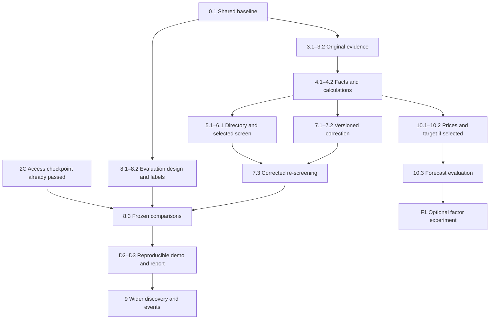

# Work chats and task catalogue

[Start](../README.md) · [Milestone status](../STATUS.md) · [Design](design.md) · [Resource packs](sources.md#resource-packs-for-work-chats)

Prepared **29 October 2026**, from the current working tree. This is the assignment catalogue; STATUS owns milestone completion, Design owns invariants, and Sources owns external references. Task IDs below refine the existing milestone numbers. A task is planned until its result and checks are accepted; a chat or a document existing does not mean its work is done.

## The whole project

Fieldnote's core deliverable is a source-backed company report and a bounded company screen, with real claim correction and an experiment showing whether review helps. Keep the current local Python/React/SQLite architecture. Development chats are people/agent workspaces; they are separate from the proposed runtime research roles.

| Direction / module | Current position | Remaining outcome | Owner |
|---|---|---|---|
| Local app, API, worker, storage | Implemented; regression coverage recorded in STATUS | Preserve recovery, local access, immutable sources and old reports as contracts evolve | C0 |
| Setup, Connections, optional model review | Implemented controls; live SEC and model pair passed | Connection checkpoint complete; maintain existing guards | C2 |
| Filing evidence | Current company-facts snapshots and generated excerpts | Independently checked original filing/table packet | C1 |
| Financial facts and calculations | Narrow annual USD revenue/income/margin; Decimal arithmetic | Typed provenance, compatibility checks, immutable inputs and formula versions | C1 |
| Identity and company lookup | Five hardcoded issuers and ticker types | Searchable SEC US directory with explicit coverage | C3 |
| Selected-company Discovery | Five-company screen; pass/fail/unknown; alphabetical selection | Up to ten explicitly selected companies, persisted universe and honest partial coverage | C3 |
| Objections and corrections | One interpretation/critic pass; objections remain unresolved | Version-targeted checks, changed/unchanged/unresolved outcomes, dependent recomputation and re-screening | C4 |
| Evaluation | Protocol exists; research quality unvalidated | Independent gold, held-out comparisons, coverage/harm/cost results | C5 |
| User experience | Research, Discovery, History, Connections, evidence inspector, names/archive | Expose the new evidence/search/correction behavior accessibly | C6 |
| Reproducibility and submission | Launcher, tests and saved teaching examples exist | Clean setup/restore proof, honest demo and final report | C7 |
| Wider discovery and events | Planned extension | Declared automatic universe and cited filing events/material risks | C8 |
| Prices and forecasts | Forecast explicitly unavailable | Validated prices/calendar, frozen target, chronological baseline and uncertainty | C9 |
| Factor research and other markets | Deferred research | Only a separately scoped experiment after data/baselines exist | C10 |

**Core finish line:** milestones 3–8, accessible integrated behavior and reproducible delivery. The model-access checkpoint has passed; preserve it as those features change. A bounded tool decision must produce an inspectable outcome, and the evaluation must report both benefits and harm. Wider discovery (9) and forecasting (10) extend that finish line. A forecast or profitable strategy is not required to establish whether evidence review improves this application.

## Which chats to open

Create chat titles from the table. Keep one integration chat and at most two active implementation chats; create later chats when their dependencies are ready. Read-only evaluation design can accompany implementation. A lane can contain several sessions, but each assignment is **one task ID**, not the entire lane.

| Chat title | Start condition | First assignment | Resource pack |
|---|---|---|---|
| **C0 — Integration and scope** | Now | 0.1: establish the shared baseline and assignments | R0 |
| **C1 — SEC evidence and financial correctness** | Now, after baseline | 3.1: original MSFT FY2024 evidence packet | R1 |
| **C2 — Model output and provider compatibility** | Checkpoint complete | Reopen for a concrete failure or agreed provider/model change | R2 |
| **C3 — Company search and selected screening** | After 4.1; prototype identity decisions read-only earlier | 5.1: directory and identity rules | R3, R1 |
| **C4 — Claim correction and re-screening** | After 4.2 | 7.1: versioned claim/objection records | R4, R1 |
| **C5 — Evaluation and independent cases** | Now for protocol/case design | 8.1: case matrix and scoring rules | R5 |
| **C6 — UI and interaction verification** | When a feature's contract is agreed | U1: original evidence and calculation inspection | R6 |
| **C7 — Demo, reproducibility and report** | Outline now; release checks after core integration | D1: delivery checklist and experiment/report outline | R7 |
| **C8 — Wider discovery and filing events** | Core complete and extension scope selected | 9.1: declared automatic universe | R8 |
| **C9 — Prices and statistical forecasting** | Separate scope/budget selected; stable identity first | 10.1: one-provider price acceptance packet | R9 |
| **C10 — Factor experiments and later directions** | C9 baseline evaluated; one hypothesis selected | F1: one preregistered factor experiment | R10 |

**Recommended first wave:** C0 sets the baseline; C1 does 3.1 and C5 does 8.1. C2's live connection checkpoint is complete; proceed to original-table verification. C7 can outline delivery without writing an unsupported results section.



UI tasks U1–U3 follow the respective agreed feature contracts; release also requires those integrated interactions. C9 may run separately once scoped; its research must not delay the core milestone by default.

## Assignment and handoff rules

1. **C0 records one baseline commit and the owner of each active task.** This checkout already contains staged, unstaged and untracked work. Review/preserve it first; do not reset, clean, bulk-stage or invent a clean baseline. Creating a baseline commit is a separate repository action, not something this catalogue has performed.
2. **Use isolated worktrees for concurrent edits after the baseline exists.** A worktree contains committed content, not another checkout's uncommitted work. Until then, edit sequentially. Keep test databases/screenshots separate. Current Playwright config fixes port 8000; serialize browser suites unless an explicit isolated configuration is agreed. Keep the existing server running unless its owner coordinates a stop.
3. **Agree shared contract changes before callers.** C0 coordinates contracts.py, store.py, api.py and application.py; the feature owner supplies the smallest complete implementation and compatibility cases. C6 owns App.tsx/api.ts/styles.css interactions. This is change coordination, not a requirement that C0 write every shared-file patch.
4. **Stay inside the assignment.** Trace the relevant invariant and existing caller first. Read STATUS, the selected task, relevant Design sections and its resource pack; inspect other modules only for a concrete dependency. Hand unrelated findings to C0. Existing correct behavior is reused.
5. **Preserve credentials and experimental separation.** Use mocks/saved sources for automated tests. A task brief does not authorize purchases, new paid experiments or wider evidence sharing. Follow any existing explicit authorization for live calls, otherwise get a concrete allowance/consent before them. Implementation/tuning chats receive development cases and schemas, not held-out answers.
6. **Finish one task and hand it back.** Report task ID, base/result commit or exact changed files, accepted behavior, commands/results, evidence location, unresolved limitations and the next dependency. C0 integrates one change at a time and updates milestone status from that evidence. Evaluation needs independent checking; agent-generated labels are provisional until reviewed.

### Copy into a new work chat

Replace the three bracketed fields; the selected task below supplies the scope and acceptance criteria.

```text
Continue Fieldnote in D:\HKU\COMP7608_Large_language_models\stock_research
(or the isolated worktree assigned by C0).
Assignment: [chat ID and task ID]. Baseline: [commit/worktree].
Read STATUS.md, docs/workstreams.md for this task and assignment rules,
then only the relevant docs/design.md sections and resource pack in docs/sources.md.
Deliver exactly this task's acceptance criteria, preserving existing invariants
and old saved reports. Inspect current changes before editing; coordinate shared
contracts/files with C0 and UI changes with C6. [Any additional constraint].
Use the task's smallest sufficient verification. Return changed files/commit,
checks and evidence, unresolved limits and the next dependency. Stop at that boundary.
```

## C0 — Integration and scope

**Owns:** milestone order, shared contract decisions and integration. **Starting files:** STATUS, Design, contracts.py, store.py, api.py, application.py. Resource pack: [R0](sources.md#r0-project-and-integration).

| Task | Concrete output and acceptance | Verification / dependency |
|---|---|---|
| **0.1 Shared baseline** | Inventory existing changes without losing work; agree baseline/worktree and active file owners; record core vs selected extensions. | Review Git status/diff and active chats; no baseline claimed until recorded. First task. |
| **0.2 Integration checkpoint** | After each feature, accept its contract, legacy-read behavior and consumer wiring; update STATUS only from proof. | Relevant backend checks; production build/browser checks when UI/API changed. Repeat per integration. |
| **0.3 Core acceptance** | One real packet → checked facts → bounded correction → changed candidate selection is inspectable; evaluation and delivery artifacts resolve to saved inputs. | End-to-end core case plus partial/unresolved case; D2/D3 and 8.3. |

Resolve deadline, current group capacity, experiment allowance, final submission requirements and whether forecasting is included before assigning calendar dates. These unknowns do not block 3.1 or 8.1. Avoid adding runtime agents solely to match the number of work chats.

## C1 — SEC evidence and financial correctness

**Owns:** evidence authenticity, eligibility and deterministic arithmetic. **Starting files:** research.py, Evidence/Metric in contracts.py, store.py snapshot/evidence methods, tests/test_system.py. **Boundary:** no company-directory rollout or narrative adjudication. Resources: [R1](sources.md#r1-sec-filings-and-financial-calculations).

| Task | Concrete output and acceptance | Verification / dependency |
|---|---|---|
| **3.1 Original filing packet** | For MSFT FY2024, identify the original 10-K accession and statement table; independently check revenue and operating income, table scale and annual dates against the saved company-facts selection. Save raw bytes, URLs, locators, hashes, availability/retrieval dates, normalized values and discrepancies. | Recompute margin from the two checked figures; another person reviews the table/value mapping. Current aggregates remain labelled as such. No model dependency. |
| **3.2 Packet retrieval and replay** | Extend the existing source path to preserve one accession-specific filing/table packet; surface the exact source instead of treating a generated excerpt as the original table. Historical saved reports still open. | Focused tests for accession/issuer, cutoff, failed/oversize retrieval and byte-stable replay with no network. Depends 3.1; agree storage/Evidence changes with C0. |
| **4.1 Typed fact validation** | Persist raw/normalized value, unit/scale, concept, issuer, instant/duration, basis/scope, accession and evidence reference for the narrow supported concepts. Unknown scope is explicit; incompatible/ambiguous facts are rejected or unavailable. | Fixtures for wrong issuer/unit/duration/scope, duplicate/conflicting tags and amendment/cutoff. Legacy migration/read proof. Depends 3.2. |
| **4.2 Calculation records** | A named/versioned margin formula references immutable validated input facts; result or typed failure persists. Old calculations remain reproducible without replacing their inputs with newer facts. | Known aligned result, zero/negative denominator, missing/incompatible inputs and old-run replay. Depends 4.1. |

Handoff: one checked real packet plus mismatch fixtures and stable fact/calculation references. General XBRL coverage, quarterly metrics, valuation and a large ratio library are later scope, not prerequisites for this packet.

## C2 — Model output and provider compatibility

**Checkpoint complete, 29 October 2026; maintenance only.** An initial live MSFT interpretation/critic pair passed with the existing configuration. A later schema/prompt fix made the existing no-digit rule explicit, and a live AAPL pair then passed. The original failed answer was not retained, so its exact wording/cause remains unknown. Source-reference and numerical-text rejection messages now explain the distinct failures. See [recorded checks](../STATUS.md#recorded-checks) for saved runs, responses and regression evidence. These checks establish access and validated output on those cases; broad reliability and research correctness remain unmeasured.

**Owns:** valid bounded model requests/outputs and observable provider failures. **Starting files:** application.py review_company/ask, model_access.py, tests/test_model_checks.py, tests/test_model_access.py. **Boundary:** preserve semantic/evidence validation; a passing provider check is not a quality result. Resources: [R2](sources.md#r2-model-contracts-and-provider-access).

| Completed checkpoint | Delivered result | Evidence / remaining limit |
|---|---|---|
| **2C.1 Diagnosis recorded** | Documented the missing original answer and separated source-reference from numerical-text rejection messages; representative failures have regression coverage. | Exact reproduction of the original response is unavailable. Do not reopen the task to recover wording that was never saved. |
| **2C.2 Valid live pair** | Interpretation and critic passed on saved real MSFT evidence with the existing configuration; usage and both responses were retained. | Saved completed run in STATUS; provider access does not resolve the critic's source-support concerns. |
| **2C.3 Qualitative-output fix** | Published the existing interpretation text restriction in the response schema and clarified dates/filing names versus evidence IDs in the prompt; retained the host guard. A live AAPL pair passed afterward. | Outgoing-schema and failure/workflow regression evidence plus saved AAPL responses in STATUS; one passing pair is not a reliability estimate. |

Reopen C2 only for a concrete new failure or an agreed provider/model change. Start with the saved response, preserve usage and financial results, reproduce offline and add a focused regression; any new live check follows applicable authorization. C5 owns broad reliability measurement. Provider/model switching or new budgets require a concrete decision; no broad provider framework is needed.

## C3 — Company search and selected screening

**Owns:** issuer lookup and the declared selected universe. **Starting files:** UNIVERSE/Ticker/RunRequest/Screen/Candidate in contracts.py, research.py issuer resolution, screening.py, application.py run_discovery, API configuration. **Boundary:** directory membership is neither financial coverage nor historical index membership. Resources: [R3](sources.md#r3-company-identity-and-screening), R1.

| Task | Concrete output and acceptance | Verification / dependency |
|---|---|---|
| **5.1 Directory and identity** | Save a dated SEC ticker/company directory; search by name/ticker and resolve to CIK. Handle multiple share classes/aliases explicitly; preserve each report's saved identity. Missing sector stays unknown unless backed by an agreed metadata source/mapping. | Outside-five issuer, ambiguous/invalid input, duplicate CIK/share class and directory-fetch failure tests. Depends 4.1 and C0 identity decision; current ticker Literal affects every report/evidence/candidate. |
| **5.2 Search-to-report path** | API and C6 UI let a user select an outside-five company and request the existing narrow financial report; unsupported concepts/currency return explicit coverage limitations. | Selected identity reaches the right issuer; existing five fixtures/old saved URLs still work. Depends 5.1; coordinate UI as U2. |
| **6.1 Selected-universe screen** | Persist 1–10 selected issuer identities and directory snapshot/date; validate duplicates and limits. Report every selected company's available/missing inputs, pass/fail/unknown and selected status, with explicit deterministic ordering. | More than five companies, impossible filters, unknown sector/margin, retrieval failure and budget-limited partial result; frozen/replay retain the original universe. Depends 5.2/4.2. |

Handoff: saved selected-universe run and coverage/failure cases. Preserve shared limits; ten companies with optional review may exhaust the existing model budget, so return fewer reviewed results rather than silently raising limits.

## C4 — Claim correction and re-screening

**Owns:** objection-to-action-to-disposition behavior and dependency invalidation. **Starting files:** Claim/Review contracts, application.py review_company, calculation records from C1, screening.py, store.py. **Boundary:** C1 owns fact truth, C5 owns gold labels; arbitrary URLs/code execution remain outside model authority. Resources: [R4](sources.md#r4-review-and-correction).

| Task | Concrete output and acceptance | Verification / dependency |
|---|---|---|
| **7.1 Versioned targets** | Objections reference immutable claim ID/version and requested typed check; retain originals, input dependencies and resolution evidence. Stale/out-of-run targets fail validation. | Version mismatch, unknown target/evidence, old report read and repeated objection cases. Depends 4.2; one agreed contract change with C0. |
| **7.2 Bounded resolution** | Host executes allowlisted recomputation/source checks; append corrected, unchanged or unresolved disposition and evidence. Corrected inputs invalidate/recompute dependent values/claims; unsupported narrative concerns remain unresolved. Preserve the proposed maximum two review rounds within existing shared limits. | Wrong value corrected, correct value unchanged, unresolvable semantic concern, hostile source and exhausted-budget cases. Depends 7.1; prove affected and unaffected dependencies. |
| **7.3 Discovery re-screening** | Re-screen affected candidates after review; exclude newly ineligible candidates and try the next eligible company in the saved universe under the same budget. Save before/after selection and reasons. | Threshold crossing changes selection; unknown cannot qualify; insufficient candidates and exhaustion return fewer results. Depends 7.2 and 6.1. |

Handoff: traceable before/objection/check/after cases for all three dispositions and one changed selection. A scripted teaching correction is useful as a fixture, but the application must execute the transition against real supported records.

## C5 — Evaluation and independent cases

**Owns:** study protocol, case manifest, scoring and held-out results. **Starting files:** Design evaluation section, current tests/fixtures for case ideas, checked C1 packets when available. **Boundary:** implementation agents receive development cases only; held-out labels are separate from prompts and tuning. Resources: [R5](sources.md#r5-research-evaluation).

| Task | Concrete output and acceptance | Verification / dependency |
|---|---|---|
| **8.1 Protocol and case matrix** | Define the research question, development/held-out split, case inclusion, labels/status rubric and primary/secondary metrics before experiments. Cover clean facts, wrong period/unit/scope, amendments, missing data, bad citation, impossible screen, provider failure and hostile text. | Map every case family to expected observable behavior and a scoring rule; distinguish natural errors from injected defects. Can start now; report expected sample size and exploratory limits. |
| **8.2 Checked gold and freeze** | Build independently checked packets/calculations/material claims and risk labels; double-label a subset, resolve disagreements, record source availability and freeze case IDs/hashes. | Separate inputs from answers; no test/development overlap; record who checked what and unresolved labels. Depends C1 checked packets; human/independent review required before calling labels gold. |
| **8.3 Comparison and analysis** | Run comparable deterministic, tool/self-review and critic-follow-up conditions; include specialist-without-critic when claiming a role-organization benefit. For review attribution, compare the same draft/evidence with no revision, self-review and critic-guided revision. Save reproducible manifests and paired results. | Score correctness + coverage, valid objections, fixes, harmful changes/withdrawals, risks, discovery changes, useful checks, failures, actual cost/tokens and latency. Report paired task-level uncertainty and repeat a subset. Depends 8.2, 7.3, valid model access and agreed experiment budget. |

Handoff: frozen protocol, case provenance, scripts, raw outputs, tables and limitations; negative results count. Benchmark performance and software test counts do not establish investment performance.

## C6 — UI and interaction verification

**Owns:** frontend presentation and browser checks, not financial truth. **Starting files:** frontend/src/App.tsx, api.ts, styles.css, tests/workspace.spec.ts and verification/design-contract.md. Resources: [R6](sources.md#r6-ui-and-browser-verification).

| Task | Concrete output and acceptance | Verification / dependency |
|---|---|---|
| **U1 Evidence/calculation inspection** | Show original table/source, dates, units and calculation inputs; distinguish old aggregate-only reports, real filings and synthetic examples. Keep diagnostics disclosed. | Focus/citation return, keyboard, mobile/long content, missing evidence and legacy report browser cases; production build. Depends C1 contract for 3.2/4.2. |
| **U2 Company selection and coverage** | Search/select companies, show saved universe and per-company coverage, and submit the existing explicit research/screen intent. Refresh/reconnect preserves uncertain submissions. | Outside-five selection, limit/duplicate feedback, unsupported data, unknown filters, partial run and recovery; build/browser checks. Depends C3 agreed 5.2/6.1 contract. |
| **U3 Correction inspection** | Present original claim, objection, performed check, result and changed selection; unresolved is readable and distinct from supported. A completed run is not shown as a proof badge. | Changed/unchanged/unresolved, exhausted run, evidence links, keyboard and 390px layout; build/browser checks. Depends C4 contract. |

Handoff: targeted browser results and inspected desktop/mobile captures. Attach each UI slice to its feature integration; avoid an unrelated redesign or one large end-stage UI rewrite.

## C7 — Demo, reproducibility and report

**Owns:** delivery proof and the explanation of measured results. **Starting files:** README, start.ps1, requirements.lock, frontend/package-lock.json, STATUS recorded checks, evaluation artifacts and course guideline linked in Sources. Resources: [R7](sources.md#r7-reproducibility-and-academic-delivery).

| Task | Concrete output and acceptance | Verification / dependency |
|---|---|---|
| **D1 Delivery outline** | Map course requirements to app behavior, evaluation evidence, report sections and demo steps; flag missing deadline/format/team decisions. Outline real, synthetic, live and replay segments explicitly. | Each planned claim points to required evidence; no placeholder is represented as a result. Can start now. |
| **D2 Reproduction and recovery** | Use documented setup on a clean environment/isolated data directory; verify saved demo without model keys, stopped-server full-data backup/restore and old-report compatibility. Package only evidence whose sharing rights permit it. | Backend suite, UI build, browser suite, setup and restore proof; secrets excluded. Depends core integration/U1–U3. Coordinate server/port ownership. |
| **D3 Demo and final report** | Demonstrate checked real evidence, an executed correction, changed screening and a partial/unresolved case. Explain contribution/baselines, measured results, limitations, costs and reproduction commands. Label injected errors and synthetic segments. | Every reported number resolves to 8.3 artifacts; runnable links/demo; confirm actual submission format rather than assuming proposal format. Depends 8.3/D2. |

## C8 — Wider discovery and filing events (extension)

**Owns:** expansion beyond a user-selected list and dated qualitative evidence. **Starting files:** C3 universe/identity path, retrieval/evidence contracts, screening.py; event UI coordinated with C6. Resources: [R8](sources.md#r8-wider-discovery-and-events).

| Task | Concrete output and acceptance | Verification / dependency |
|---|---|---|
| **9.1 Automatic universe** | Define one bounded universe/snapshot and candidate-generation rule; separate searched, retrieved, eligible and selected counts. No full-market or historical membership claim without supporting coverage. | Repeatable candidate list, missing data, insufficient candidates and budget exhaustion; depends core acceptance and chosen extension scope. |
| **9.2 Filing events and risks** | Add one 8-K/exhibit or annual-risk extraction path with publication/availability date, archived excerpt and attribution. Contradictory/missing support stays qualified. General news waits for a rights/source decision. | Citation correctness, cutoff, duplicate/syndicated evidence, hostile text and retrieval failure cases; independent sample check. Depends 9.1/stable evidence records. |

## C9 — Prices and statistical forecasting (extension)

**Owns:** a separate statistical artifact, not narrative price predictions. **Starting point:** Design's proposed forecast protocol; no trained forecast implementation currently exists. Resources: [R9](sources.md#r9-prices-and-forecasting).

| Task | Concrete output and acceptance | Verification / dependency |
|---|---|---|
| **10.1 Price acceptance packet** | Select one provider after checking access/cost/storage/demo rights. Save raw prices, adjustments, actions, calendar and identity; inspect one split and dividend by hand. | Adjustment consistency, missing/delisted data, SPY alignment and explicit coverage. Requires chosen scope/provider entitlement; no purchase implied. |
| **10.2 Target and labels** | Freeze target/version, cutoff, issuance, next-session anchor and 20-session endpoint; persist actual dates and unresolved labels. Preserve target changes as new versions. | Holiday/DST/session boundaries, late issuance, exactly 20 close-to-close intervals and matured outcomes. Depends 10.1; use existing Design conventions unless deliberately revised. |
| **10.3 Baseline and evaluation** | Evaluate constant 0.5, training base rate and pooled regularized logistic regression with frozen simple features, training-only transforms, date-based splits and overlapping-label exclusion. Save immutable p0 independently of review. | Reproducible chronological experiments; Brier/log loss/reliability/sample size/coverage and date-block uncertainty; untouched test. Depends 10.2; no profitability claim from probability metrics. |

## C10 — Factor experiments and later directions (optional)

Resources: [R10](sources.md#r10-factors-and-other-later-research). This lane is a parking place for bounded experiments, not an outstanding core implementation requirement.

| Topic | Next concrete assignment / entry gate |
|---|---|
| **F1 One factor hypothesis** | After 10.3, choose one fundamental, technical, GP, neural or LLM-derived feature hypothesis; freeze feature availability, trial registry, baselines, held-out test and multiple-trial reporting. Deliver one experiment with failed hypotheses included. |
| Valuation / extra ratios | First define the user decision and aligned price/share/accounting dates; implement one checked formula through C1's fact/calculation path. |
| Macro / global coverage | Choose one question/market, validate data vintages, currency/accounting/identity and rights before changing the supported scope. |
| Portfolio / execution | Separate project decision: positions, costs, turnover, constraints, broker authority and operational risks need their own specification. No order placement belongs to the core research app. |
| Hosted / multi-user product | Separate deployment decision: authentication, authorization, tenant separation and operational ownership must precede public hosting. Current app remains local. |

## Checkpoints and smallest sufficient proof

| Checkpoint | Required proof before advancing |
|---|---|
| **Evidence ready** | 3.1–4.2 accepted; original table, typed compatible inputs, immutable calculation and legacy/replay checks. Directory/correction callers can now use the contract. |
| **Research loop ready** | 5.1–7.3 and U1–U3 accepted; real source path plus executed corrected/unchanged/unresolved transitions and re-screening, with partial-run behavior preserved. |
| **Study ready** | 8.1/8.2 frozen, completed model path, comparable budgets/conditions and experiment authorization. Human review of gold precedes running held-out comparisons. |
| **Core delivered** | 8.3, D2/D3 and 0.3 accepted; runnable demo, reproducible results and explicit uncertainty. Decide whether extensions are still needed. |

Use `.\.venv\Scripts\python.exe -m pytest -q <focused test file>` for a backend slice. Build with `npm.cmd --prefix frontend run build` when frontend/contracts change, and run the relevant Playwright scenario with `npm.cmd --prefix frontend test -- --grep "<scenario>"` when interactions change. C0/C7 run the full suites at integration/release checkpoints. Documentation-only planning needs link/consistency review, not paid calls or application test reruns.
